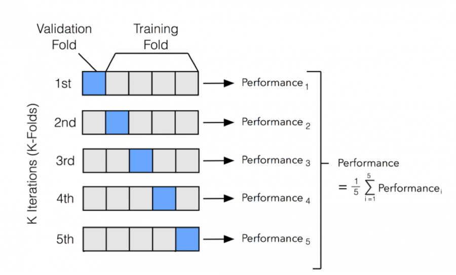
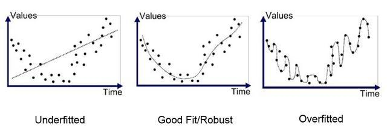

# Good evening again!

So lets start with:
1. Any questions, concerns or thoughts from our last lecture? 
2. So one from me, what did we talk about last time? 
3. And, what actually is a neural network?

Some quick terms to repeat:
1. Layer
2. Weight
3. Activation function
4. Loss
5. Batch
6. Epoch

# DL in Classic Problems

Today we take the network from last class and point it at the two problems you already know from classic ML:

1. **Regression** – predict a number. How much will this house cost? How many units will we sell next week?
2. **Classification** – predict a category. Is this review positive? Which of 46 topics is this news article about?

The good news: the network itself barely changes. What changes is the **last layer**, the **loss** and the **metric**. If you get those three right, you are 80% there.

Notebooks for today:
1. [Regression – California housing prices](code/regression.ipynb)
2. [Classification – IMDB reviews (binary) and Reuters newswires (multi-class)](code/classification.ipynb)

# Framing the problem first

Before you write a single layer, answer these:

1. What is my **input**? (a row of numbers, a sequence of words, an image)
2. What is my **output**? (one number, several numbers, one class, several classes at once)
3. How will I know the model is **good**? (which metric, compared to what baseline)
4. Do I have **enough data** for the size of the model I'm planning?

Lets remember that networks work on representations. Whatever your data is, it has to end up as a tensor of floats. For text in the classification notebook we do it the crude way – multi-hot vectors of 10 000 words. Ask yourself: what are we losing with that encoding? (Spoiler: word order. More on that next class.)

# The cheat sheet: last layer + loss

This is the table to remember from today:

| Problem | Example | Last layer | Loss | Typical metric |
|---|---|---|---|---|
| Regression (one value) | House price | `Dense(1)` (no activation) | `mse` (or `mae`, `huber`) | MAE, RMSE |
| Regression (many values) | x, y coordinates | `Dense(n)` (no activation) | `mse` | MAE |
| Binary classification | Positive / negative review | `Dense(1, sigmoid)` | `binary_crossentropy` | Accuracy, ROC-AUC, F1 |
| Multi-class, one label | One of 46 topics | `Dense(K, softmax)` | `categorical_crossentropy` (one-hot labels) or `sparse_categorical_crossentropy` (integer labels) | Accuracy, top-k accuracy |
| Multi-label | Several tags per article | `Dense(K, sigmoid)` | `binary_crossentropy` | F1, precision / recall |

Why these pairings?

1. **No activation for regression.** Any activation squeezes the output into a range (sigmoid → (0, 1), tanh → (-1, 1), ReLU → [0, ∞)). For a price we want the whole real line, so we leave the last layer linear.
2. **Sigmoid for binary.** It turns any number into a value in (0, 1) that we read as "probability of class 1".
3. **Softmax for multi-class.** It turns K numbers into K probabilities that sum to 1. Check `np.sum(predictions[0])` in the notebook – it's 1.
4. **Sigmoid per output for multi-label.** Each class is its own yes/no question, so probabilities do *not* have to sum to 1.

# How a loss actually works

The loss is the one number the network is trying to make smaller. Gradient descent doesn't care about your business goal, it only sees the loss – so the loss is how you tell the network what "good" means.

**Regression losses**

- **MSE (mean squared error)** – average of `(y_true - y_pred)²`. Squaring punishes big mistakes a lot. Standard choice.
- **MAE (mean absolute error)** – average of `|y_true - y_pred|`. Every unit of error costs the same, so it's more robust to outliers. Also easy to explain: "on average we're off by $X".
- **Huber** – behaves like MSE for small errors and like MAE for large ones. A good default when your data has some crazy outliers.

In the regression notebook we train on MSE but *report* MAE. That's normal: the loss has to be smooth for gradients, the metric has to be understandable for humans.

**Classification losses**

- **Crossentropy** measures how far the predicted probability distribution is from the true one. For a single example it's `-log(p_correct)`:
  - model says 0.9 for the correct class → loss ≈ 0.1
  - model says 0.5 → loss ≈ 0.7
  - model says 0.01 → loss ≈ 4.6

  So being confidently wrong is punished hard. That's exactly the behaviour we want for probabilities.
- **Why not MSE for classification?** You can (try it in the notebook!), but combined with sigmoid/softmax the gradients get tiny when the model is very wrong, so it learns slower and calibrates worse.
- **categorical vs. sparse_categorical** – same loss, different label format. One-hot labels `[0, 0, 1, 0]` → `categorical_crossentropy`. Integer labels `2` → `sparse_categorical_crossentropy`. Mixing them up is one of the most common errors you'll see.

**Metrics are not losses.** Accuracy can't be optimized directly (it's not differentiable), so we optimize crossentropy and *watch* accuracy. You can also define your own metric, e.g. top-3 accuracy for the Reuters problem.

# General rules to start with

Also when you have a tabular data and you wander what to start with:

When you get a tabular dataset, do not overthink architecture.

Start with this baseline. Always.

Preprocessing (mandatory) is simple:

- Numerical features → standardize  
- Categorical features → one-hot (or embeddings if large)  
- Handle missing values  

When it comes to baseline model start with:

Dense(64) → ReLU  
Dense(32) → ReLU  
Dense(output)

That’s it.

In output:

- Binary classification → Dense(1, sigmoid)  
- Multi-class → Dense(K, softmax)  
- Regression → Dense(1) (no activation)  

- Optimizer → Adam  
- Loss:
  - Binary → binary_crossentropy  
  - Multi-class → sparse_categorical_crossentropy  
  - Regression → mse  

- Batch size: 32  
- Epochs: 20–50  
- Add EarlyStopping  

After training, ask:

- Did loss decrease?  
- Does validation make sense?  

If not → fix data, not model.

Only then:

If underfitting:
- Increase number of neurons in a layer (64 → 128) - mind bottlenecks
- Add one more layer  

If overfitting:
- Add Dropout(0.2–0.5)  
- Reduce size  

# How big should the network be?

There is no formula, but there are good rules of thumb:

1. **Small data → small model.** With a few thousand rows (like California housing) two layers of 64 is plenty. A big model will just memorize.
2. **Layers should not be narrower than the output needs.** Reuters has 46 classes – a hidden layer of 4 units is an **information bottleneck**: it can't carry enough information to separate 46 topics. The notebook shows how accuracy collapses.
3. **Depth vs. width.** For tabular data, 2–3 layers is usually enough. Going deeper pays off for images, text and audio, where there is structure to learn in stages.
4. **Know your baseline.** What does a model that guesses get? For a balanced binary problem it's 50%. For Reuters, shuffling the labels gives ~19%. For regression, predict the mean and compute the MAE. If your network doesn't clearly beat that, something is wrong.

# Data first

In deep learning projects, performance problems are often caused by data issues rather than model architecture (like most ML problems, but here intensified). Before modifying your network, you should critically examine your dataset.

1. **Explore** – inspect distributions, check class imbalance, find missing values and outliers. A model cannot compensate for poorly understood data.
2. **Handle missing values explicitly** – neural networks cannot process NaN. Remove, impute (mean/median) or add a "missing" category.
3. **Address class imbalance** – if one class dominates, accuracy lies. Use class weights, resampling, and evaluate with F1 or ROC-AUC.
4. **Normalize features** – networks are sensitive to scale. Compute mean and std on the **training set only** and apply them to validation and test.
5. **Scale big targets** – in the regression notebook we divide prices by 100 000. The bigger the target, the bigger the weights needed to reach it, and the longer training takes. Scale down, then scale predictions back.
6. **Prevent data leakage** – no information from validation/test may influence training (scaling on the full dataset, features from the future, bad splits). Leakage gives you great results that vanish in production.

# Validation: how do we know it works?

Three datasets, three jobs:

1. **Training set** – the model learns from it.
2. **Validation set** – *you* learn from it: choose the architecture, the learning rate, the number of epochs.
3. **Test set** – touched once, at the very end. Every time you look at it and change something, it becomes a validation set.

When data is small, a single validation split is noisy. Then use **K-fold validation**: split the training data into K parts, train K models each validated on a different part, and average the scores.

# General rules for traning

We need to find the sweet spot in training.

  

Plot training and validation loss for every experiment. The moment validation loss starts going up while training loss keeps going down – that's where overfitting begins. That's your number of epochs (or let `EarlyStopping` find it for you).

When training behaves unexpectedly, the issue is almost always related to the configuration of the gradient descent process.

This typically involves:

- The choice of optimizer  
- The initialization of model weights  
- The learning rate  
- The batch size  

These parameters are interdependent. Changing one often affects the behavior of the others.

In practice, it is usually sufficient to tune the learning rate and the batch size while keeping the remaining parameters constant. Systematic adjustment is more effective than changing multiple variables at once. Remember experimentation - one parameter change per one test.

- Modify the learning rate.  
  A learning rate that is too high can cause updates to overshoot.  
  A learning rate that is too low can make training appear stagnant.

- Increase the batch size.  
  Larger batches produce gradients with lower variance and more stable updates.

# Debugging checklist

If training loss does not decrease:
1. Check input scaling.
2. Check label format (one-hot vs. integers, the right loss for it).
3. Check the last layer activation matches the problem.
4. Lower the learning rate.

If validation is much worse than training:
1. You're overfitting – smaller model, dropout, more data, fewer epochs.
2. Re-check preprocessing – are train and validation processed the same way?

Still lost? **Try to overfit on purpose.** Take 100 samples and train until training loss is ~0. If the model can't even memorize 100 examples, the bug is in your data or code, not in the architecture.

# Your turn

In the notebooks, try:
1. One or three hidden layers instead of two.
2. 32, 64, 128 units per layer.
3. `mean_squared_error` instead of `binary_crossentropy` for IMDB – what happens?
4. `tanh` instead of `relu`.
5. A 4-unit bottleneck layer in Reuters – plot the loss and accuracy.
6. Your own metric (e.g. top-3 accuracy) and what it tells you that accuracy doesn't.

Further reading: [Deep Learning with Python](https://deeplearningwithpython.io/), chapter 4 – "Classification and regression".
