# Good evening again ^2!

So lets start with:
1. Any questions, concerns or thoughts from our last lecture? 
2. So one from me, what did we talk about last time? 
3. And, how do we choose the output layer and loss for a given problem?

Some quick terms to repeat:
1. Regression vs. classification
2. Sigmoid and softmax
3. Crossentropy
4. Overfitting
5. Validation set

Notebooks for today:
1. **Warm-up from last class:** [Challenge – build it from scratch](code/challenge-from-scratch.ipynb). Pick a Keras dataset (Fashion-MNIST, California housing, Reuters or CIFAR-10), beat the baseline, run real experiments with mean ± std over seeds, and report one honest test score. Start it in class, finish it at home.
2. [Language – tokenization, bag of words, bigrams, sequences and embeddings on IMDB](code/language.ipynb)

The plan for today:

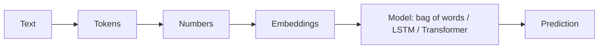

# Let's talk about language 

Let us look at these examples:  
1. Not to brag, but I’m fluent in 10 languages. English and Binary.
2. Mary asked John to leave. Mary asked to leave John.
3. I made a great deal, killed two birds with one stone.

What makes them hard for a computer?
1. The first one is a joke that only works if you know that binary has two digits – **world knowledge**.
2. The second pair has exactly the same words, but a different meaning – **word order** matters.
3. Nobody killed any birds – **idioms**: the meaning is not the sum of the words.

Add to that ambiguity ("I saw her duck"), sarcasm, typos, slang, and the fact that the same word means different things in different contexts ("bank" of a river vs. a bank with money). Language is the ultimate messy data.

What types of problems do we solve:  
1. Where in the text can i find an answer to that question? (*question answering*)
2. What is this text about? (*classification, topic modelling*)
3. How can i summarize this text? (*summarization*)
4. Is that text appropriate? (*moderation, sentiment*)
5. How do I say that in french? (*translation*)

And more broadly:  
1. How can i answer this question?
2. What is the meaning of that sentence?
3. Was that funny? 
4. How does that relate to the world?

# From text to numbers – the pipeline

A neural network only understands tensors of numbers. Every NLP system – from a 2010 spam filter to GPT – first turns text into numbers in the same four steps:

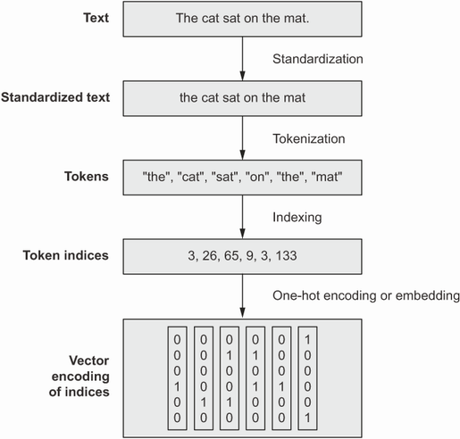  
Source: https://www.manning.com/books/deep-learning-with-python 

## Step 1: Standardize

Make the text more uniform, so that unimportant differences don't create different tokens: lowercase, remove punctuation or accents, normalize whitespace.

"Sunset came. I was staring at the Mexico sky. Isn't nature splendid??" → "sunset came i was staring at the mexico sky isnt nature splendid"

It's a trade-off: lowercasing merges "Apple" (the company) with "apple" (the fruit). For classification it usually helps; modern large models skip most of it and let the model learn the differences.

## Step 2: Tokenize

Split the text into **tokens** – the units the model will see. There are three main options:

| Level | "unbelievably good" becomes | Vocabulary size | Problem |
|---|---|---|---|
| Characters | `u n b e l i e v a b l y _ g o o d` | ~100 | Very long sequences; the model has to learn spelling first |
| Words | `unbelievably` `good` | 100 000+ | Every unseen word (typo, new name, "unbelievablyyy") becomes `[UNK]` – unknown |
| **Subwords** | `un` `believ` `ably` `good` | 30 000–200 000 | The best compromise – used by all modern models |

Subword tokenization keeps common words whole and cuts rare words into meaningful pieces. "neurobiologist" becomes `neuro + bio + logist` instead of `[UNK]` – and the model already knows what each piece means.

**How does the tokenizer learn these pieces? Byte Pair Encoding (BPE)** – used by GPT – in a nutshell:

1. Start with single characters as the vocabulary.
2. Count which **pair** of neighbouring tokens appears most often in the training text.
3. **Merge** that pair into a new token and add it to the vocabulary.
4. Repeat until the vocabulary has the size you want.

A tiny example. The training text has the words *low* (5×), *lower* (2×), *newest* (6×) and *widest* (3×):

| Merge | Most frequent pair | Why | New token |
|---|---|---|---|
| 1 | `e` + `s` | appears 9× (newest, widest) | `es` |
| 2 | `es` + `t` | 9× | `est` |
| 3 | `l` + `o` | 7× (low, lower) | `lo` |
| 4 | `lo` + `w` | 7× | `low` |

Now a word the tokenizer has **never seen**, *lowest*, is simply `low` + `est`. BERT uses a very similar method called WordPiece (you'll see pieces like `##ing`, where `##` means "glued to the previous piece").

Things to remember about tokens:
1. **Tokens are not words.** In English one word is ~1.3 tokens on average. Polish needs noticeably more tokens for the same text – we measure it in Class 6.
2. **Special tokens** carry structure: `[CLS]` (start / summary of the sentence in BERT), `[SEP]` (separator between sentences), `[PAD]` (padding), `[MASK]` (a hidden word), `[UNK]` (unknown).
3. Everything – price of an API, speed, maximum input length – is counted in tokens.

## Step 3: Index

Give every token in the vocabulary an integer ID and replace tokens with IDs:

I love dogs and dogs love snacks.  
[1 2 3 4 3 2 5]  

Usually ID 0 is reserved for padding (so that all sequences in a batch have the same length) and ID 1 for unknown tokens. In Keras, the `TextVectorization` layer does steps 1–3 for you.

## Step 4: Represent

The IDs are just names – the number 3 is not "more" than 2. So we need a representation that the network can do maths with. Lets remember that networks (and any model to be fair) work on representations. We create representations to be as efficient as possible it means - take the least space and leave the most meaning.

**Option A: a bag of words.** Forget the order, keep only *which* words appear (multi-hot vector) or *how often*. To keep a bit of order, add **n-grams** – pairs (bigrams) or triples of neighbouring words – as extra "words":

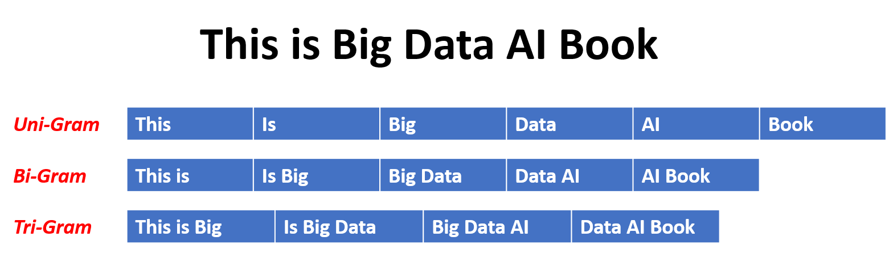  

Very common words like "the", "a", "is" (**stopwords**) carry little meaning, so they are sometimes removed:

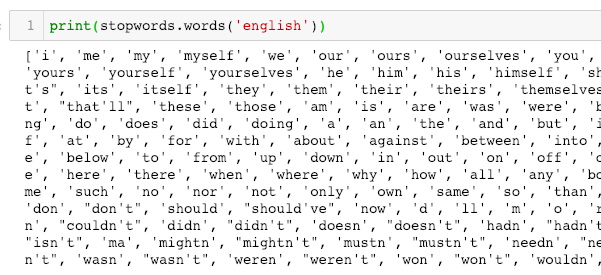

**Option B: a sequence of embeddings.** Keep the order, and replace every token by a dense vector – its **embedding**.

| Approach | What it keeps | What it loses | When it's enough |
|---|---|---|---|
| **Bag of words / bigrams** (multi-hot vectors) | Which words appear | Word order (bigrams keep a little of it) | Short texts, topic and sentiment classification, a quick baseline |
| **Sequences** (token IDs → embeddings → LSTM / Transformer) | Order and context | Nothing by design – but needs more data and compute | Translation, question answering, generation, anything where order matters |

A good rule: **always run the bag-of-words baseline first.** On IMDB it gets you ~88–89% accuracy in seconds. If a sequence model can't beat that, it's not worth its cost.

# Embeddings – meaning as geometry

A one-hot vector of a 20 000-word vocabulary is 20 000 numbers with a single 1 – and every word is exactly as far from every other word. "cat" is as different from "kitten" as from "carburettor".

An **embedding** gives every token a short dense vector instead, for example 128 numbers. These numbers are **weights**: they start random and are learned by backpropagation, like any other layer. During training, words used in similar contexts get pushed to similar vectors – so distances start to mean something:

- "cat" ends up near "kitten" and "dog", far from "carburettor",
- directions get meaning too: `vec("king") − vec("man") + vec("woman") ≈ vec("queen")`.

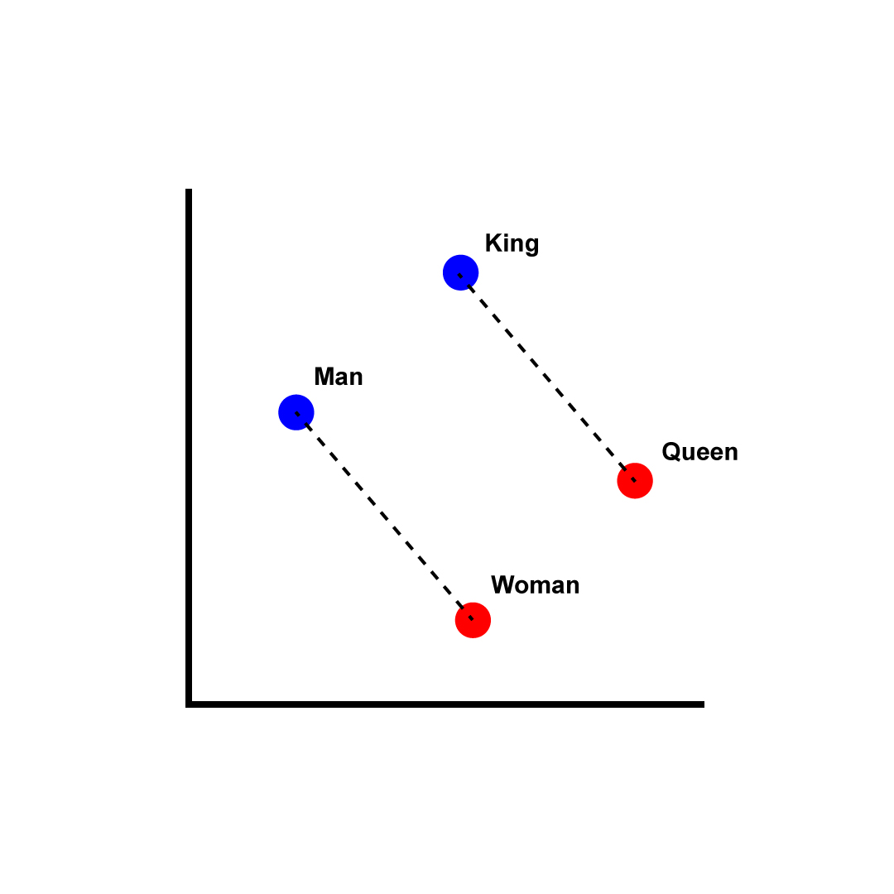

<sub>Image: Singerep, [CC BY-SA 4.0](https://creativecommons.org/licenses/by-sa/4.0/), via [Wikimedia Commons](https://commons.wikimedia.org/wiki/File:Word_vector_illustration.jpg)</sub>

An embedding layer is just a lookup table: row number = token ID, row = the vector. You can learn it from scratch for your task (as in the notebook) or start from **pretrained** embeddings (word2vec, GloVe) when you have little data.

The problem: a classic embedding gives **one vector per word**, no matter the context. "bank" has the same vector in "river bank" and "bank account". To fix this, the model must look at the **neighbouring words** – that's what sequence models do.

# Before Transformers: RNNs and LSTMs

What is a model? It's a problem representation. In this case - a language representation.  

A **recurrent neural network (RNN)** reads the sentence **one token at a time**, like you read a book. It keeps a *hidden state* – a vector that works as its memory – and updates it after every word:

```
"I"  → state₁ → "love" → state₂ → "deep" → state₃ → "learning" → state₄ → prediction
```

The same picture, "unrolled" in time: one cell (left), applied again and again to each word *x* while passing its state *h* forward (right):

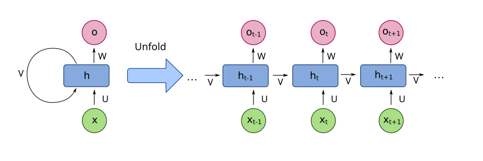
<sub>Image: fdeloche, [CC BY-SA 4.0](https://creativecommons.org/licenses/by-sa/4.0/), via [Wikimedia Commons](https://commons.wikimedia.org/wiki/File:Recurrent_neural_network_unfold.svg)</sub>

The **LSTM** (Long Short-Term Memory, 1997) is an RNN with *gates* that decide what to remember and what to forget, so it can carry information further:

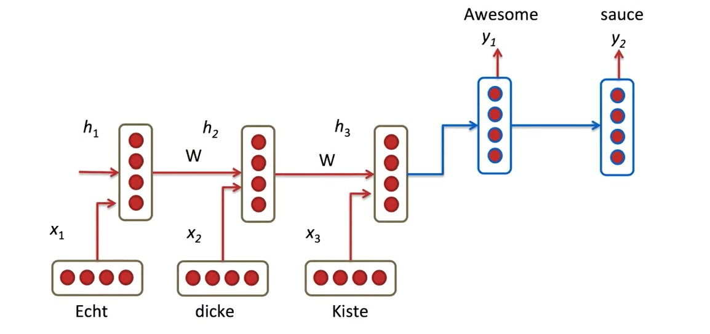

LSTMs dominated NLP until ~2017, but:
1. **Slow to train** – word 50 can only be processed after word 49. You can't parallelize across the sentence, so GPUs (Class 5) are badly used.
2. **Rather unidirectional** – a standard LSTM only knows the words *before* the current one. (A *bidirectional* LSTM – like in our notebook – runs a second one backwards, but the two halves never really talk.)
3. **No deep context perspective** – information from far back fades away; by the end of a long paragraph the first sentences are mostly forgotten.
4. **No task separation** – the model was usually trained from scratch for one task; there was no good way to "learn the language once" and reuse it.

And there's a hidden **information bottleneck** (remember Class 2?): in translation, the whole input sentence had to be squeezed into one final state vector before the decoder could start writing the output.

# Attention and the Transformer

## The idea: let every word look at every other word

In 2014–2015 researchers added **attention** to translation models: instead of using only the last state, at each step the decoder could *look back* at all the input words and decide which ones matter right now. In 2017, the paper ["Attention Is All You Need"](https://arxiv.org/abs/1706.03762) asked: what if we throw away the recurrence completely and keep **only attention**? That's the **Transformer**.

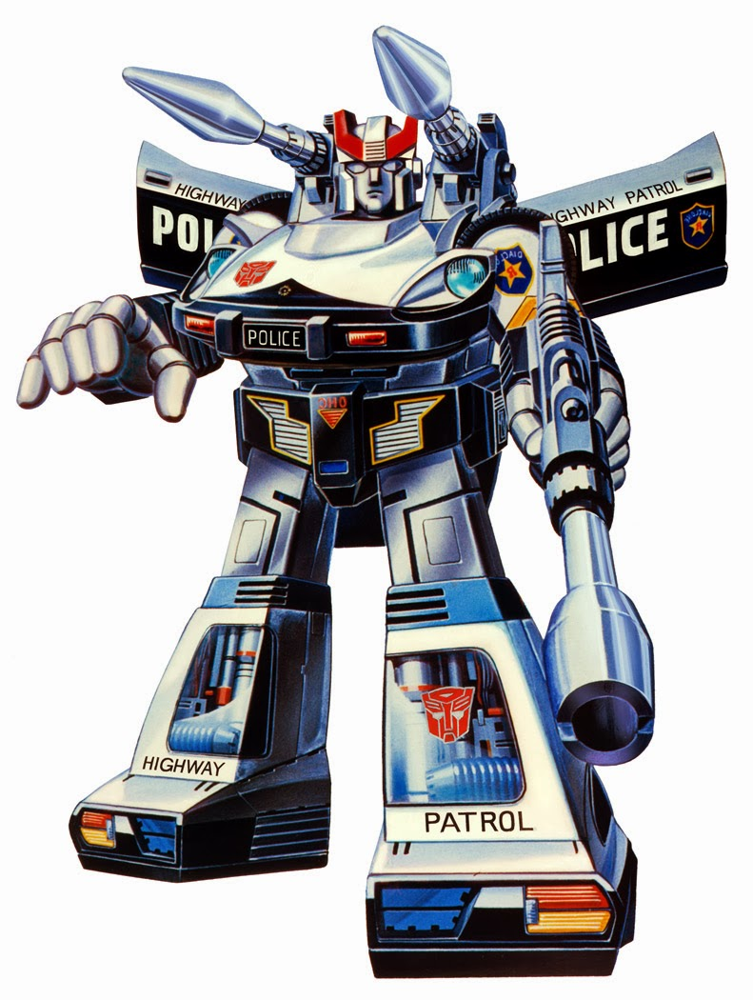

**Self-attention in plain words.** For every token, the model asks: *which other tokens in this sentence matter for understanding me?* In "The animal didn't cross the street because **it** was too tired", attention lets "it" look at "animal" rather than "street". In "…because **it** was too wide", it looks at "street".

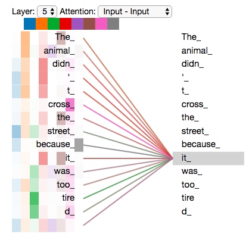  

And a real example from the original paper. Each line shows how strongly the word *making* attends to other words in one layer: it looks far ahead to *more difficult*, completing the phrase "making … more difficult":

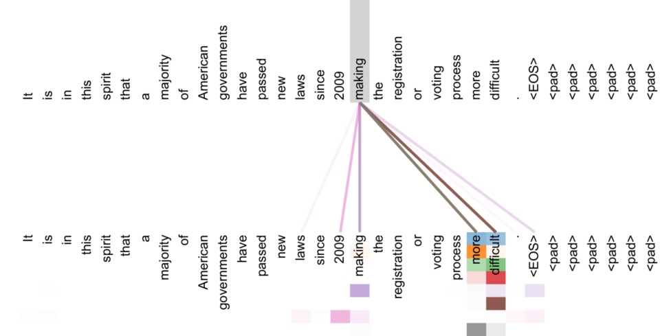
<sub>Image: Vaswani et al. (Google), "Attention Is All You Need", [CC BY-SA 4.0](https://creativecommons.org/licenses/by-sa/4.0/), via [Wikimedia Commons](https://commons.wikimedia.org/wiki/File:Attention_Is_All_You_Need_-_long-distance_attention,_encoder_self-attention_in_layer_5_of_6.png)</sub>

**How it works – the library analogy.** Every token produces three vectors (by multiplying its embedding with three learned weight matrices):
1. a **query** – "what am I looking for?",
2. a **key** – "what do I contain?" (like a book's title),
3. a **value** – "what information do I pass on?" (like the book's content).

To update the token "it", we compare its **query** with the **keys** of all tokens (a dot product – Class 1!), turn the scores into weights with a **softmax** (Class 2!), and take the weighted average of the **values**:

$$
\text{Attention}(Q, K, V) = \text{softmax}\left(\frac{QK^\top}{\sqrt{d_k}}\right)V
$$

The division by $\sqrt{d_k}$ just keeps the numbers in a range where softmax works well. The result: a new vector for "it" that now *contains* information about "animal". Same word, different context → different vector. That solves the "bank" problem.

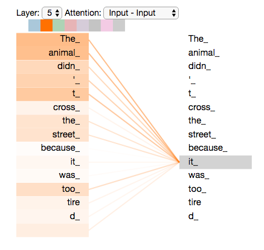  

A few more pieces complete the Transformer:
1. **Multi-head attention** – several attention "heads" run in parallel, each with its own Q, K, V matrices. Each learns a different kind of relationship: one follows grammar, one finds what a pronoun refers to, one tracks the topic.
2. **Positional encoding** – attention itself has no idea of order ("dog bites man" = "man bites dog"!). So a vector describing the *position* is added to each token's embedding.
3. **Feed-forward layers** – after attention, every token goes through a small Dense network (Class 1), separately.
4. **Residual connections and layer normalization** – tricks that let us stack dozens of these blocks without training falling apart.

Multi-head attention as a diagram – every head has its own query, key and value projections, and their results are concatenated:

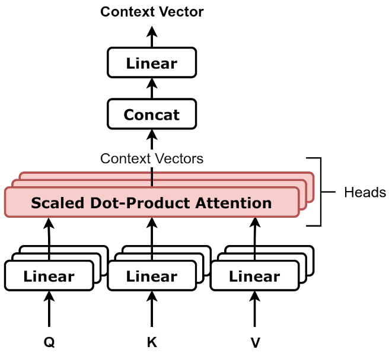

<sub>Image: Daniel Voigt Godoy, [CC BY 4.0](https://creativecommons.org/licenses/by/4.0/), via [Wikimedia Commons](https://commons.wikimedia.org/wiki/File:Multiheaded_attention,_block_diagram.png)</sub>

A **Transformer block** = multi-head attention + feed-forward. A model is a stack of N blocks (BERT-base: 12, GPT-3: 96). The original Transformer had two halves: an **encoder** (reads the input) and a **decoder** (writes the output, using *masked* attention so it can't peek at future words):

Well, the actual transformer:  

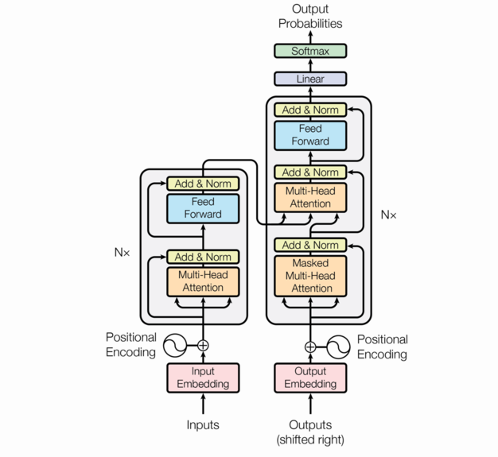

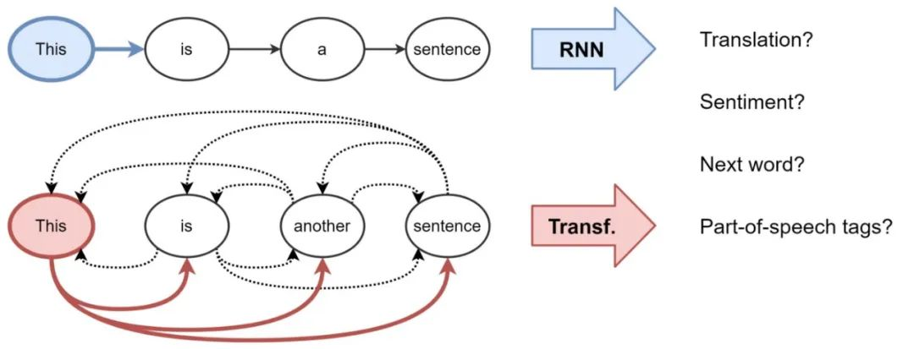

## Why was this a revolution?

1. **Parallel training.** All tokens of a sentence are processed at the same time – it's all big matrix multiplications, exactly what GPUs love. Training became many times faster, so models could be much bigger.
2. **Direct long-range connections.** Word 1 and word 500 are one attention step apart, not 499 recurrent steps. Nothing has to "survive" a long chain of memory.
3. **Context-dependent representations.** Each token's vector depends on the whole sentence – "bank" finally means different things in different sentences.
4. **It scales.** Bigger Transformer + more data + more compute = predictably better results. This ("scaling laws") is the recipe behind every large language model.
5. **One architecture for everything.** The same block now powers text (BERT, GPT), images (Vision Transformers – Class 4), speech (Whisper), protein structure (AlphaFold) and multimodal models (Class 6).

Best article on the topic I have read so far: https://writings.stephenwolfram.com/2023/02/what-is-chatgpt-doing-and-why-does-it-work/  
Very visual explanation: [The Illustrated Transformer](https://jalammar.github.io/illustrated-transformer/) by Jay Alammar.

# BERT

BERT (**B**idirectional **E**ncoder **R**epresentations from **T**ransformers, Google, 2018) is the **encoder half** of the Transformer, trained in a clever way.

BERT:
1. aim to predict the relationships between sentences by analyzing them holistically, as well as token-level tasks such as named entity recognition and question answering.
2. is designed to pretrain deep bidirectional representations from unlabeled text by jointly conditioning on both
left and right context in all layers. 
3. can create state-of-the-art models for a wide range of tasks, such as question answering,
language inference and translation.

Source: https://aclanthology.org/N19-1423.pdf [BERT: Pre-training of Deep Bidirectional Transformers for
Language Understanding]  

## Step 1: pretraining – learn the language

BERT was trained on English Wikipedia and a large collection of books (~3.3 billion words) with two "fill in the blanks" tasks. Nobody had to label anything – the text itself is the label (**self-supervised learning**):

1. **Masked language modelling.** Hide 15% of the words and predict them from the words on **both sides**:
   "The man went to the [MASK] to buy a [MASK] of milk." → *store*, *gallon*.  
   To guess well, the model must understand grammar, meaning and a lot about the world.

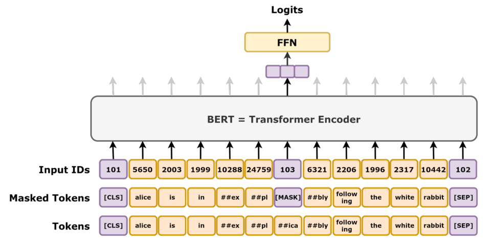
<sub>Image: Daniel Voigt Godoy, [CC BY 4.0](https://creativecommons.org/licenses/by/4.0/), via [Wikimedia Commons](https://commons.wikimedia.org/wiki/File:BERT_masked_language_modelling_task.png)</sub>

2. **Next sentence prediction.** Given two sentences, does the second really follow the first, or is it a random sentence from somewhere else?

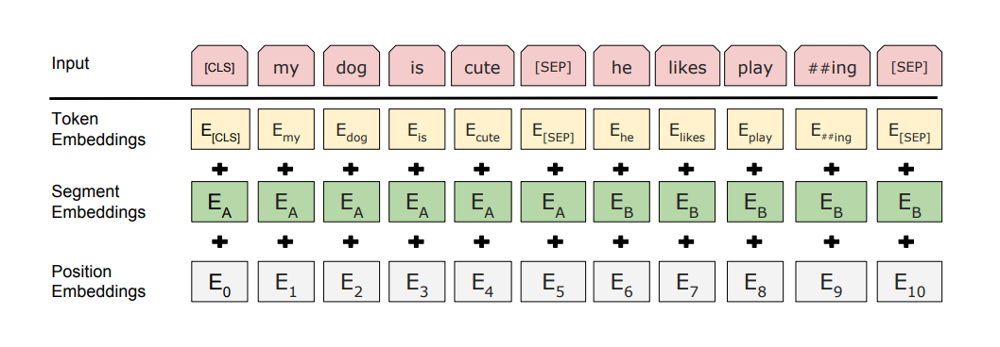

The input always starts with a special `[CLS]` token, and sentences are separated by `[SEP]`. After training, the output vector of `[CLS]` works as a summary of the whole input.

## Step 2: fine-tuning – learn your task

Now take the pretrained BERT, put a small layer on top (e.g. `Dense(1, sigmoid)` on the `[CLS]` vector for sentiment – Class 2!), and train the whole thing on your labelled data for a few epochs. A few thousand examples are often enough.

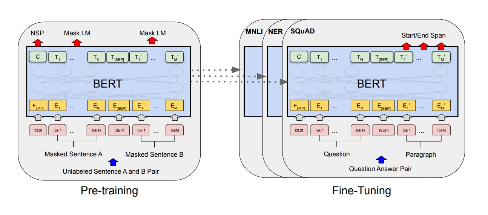
Source: https://aclanthology.org/N19-1423.pdf [BERT: Pre-training of Deep Bidirectional Transformers for
Language Understanding]  

## Why BERT was such a big deal

1. **"ImageNet moment" for NLP.** Like pretrained convnets in vision (Class 4), you no longer start from zero: the expensive part (learning the language) is done once, by someone with a lot of GPUs, and everyone else fine-tunes cheaply.
2. **Truly bidirectional.** Every word is understood using the words before *and* after it, in every layer.
3. **One model, many tasks.** The same pretrained BERT, with a different small head on top, beat the state of the art on 11 NLP tasks at once – classification, question answering, named entity recognition…
4. **Real-world impact.** In 2019 Google started using BERT in Search to better understand queries.

On SQuAD (question answering benchmark): https://rajpurkar.github.io/SQuAD-explorer/  

Fun-facts:
1. BERT_BASE contains 110M parameters and BERT_LARGE contains 340M parameters
2. BERT is a 2018 child of Google Researchers
3. Pretraining is a KEY element of BERT - we are separating understanding language from a given task
4. There's a whole family: RoBERTa (trained longer, better), DistilBERT (smaller and faster), multilingual BERT – and for Polish, [HerBERT](https://huggingface.co/allegro/herbert-base-cased) by Allegro.
5. BERT-like models are still everywhere today: search engines, document classification, and the "embedding models" that power RAG (Class 6).

If you want to dig deeper and see how to use BERT, I am redirecting you here: https://github.com/jalammar/jalammar.github.io/blob/master/notebooks/bert/A_Visual_Notebook_to_Using_BERT_for_the_First_Time.ipynb

Easy and less-easy (for eager heads) explanation of BERT: https://www.youtube.com/watch?v=xI0HHN5XKDo  
More techy with a notebook: https://www.youtube.com/watch?v=TLPmlVeEf1k  
VERY good Stanford Lecture on NLP and pretrained models: https://www.youtube.com/watch?v=knTc-NQSjKA

# GPT

BERT and GPT are both built from Transformer blocks, but they use them differently:

| | BERT | GPT |
|---|---|---|
| Part of the Transformer | Encoder | Decoder |
| Looks at | Left **and** right context | Only the left context (previous tokens) |
| Pretraining task | Fill in masked words: "I [MASK] dogs" → "love" | Predict the next token: "I love" → "dogs" |
| Best at | Understanding: classification, NER, extractive QA, search | Generating: writing, summarizing, chat, code |
| Typical use | Fine-tune a small model for your task | Prompt a big model (or fine-tune it) |

GPT generates text one token at a time: predict the next token, append it, repeat. That simple loop, scaled up to billions of parameters and trillions of tokens, is what powers today's chat assistants. We'll go deeper into generative models in Class 6.

Original papers: [GPT-1 (2018)](https://cdn.openai.com/research-covers/language-unsupervised/language_understanding_paper.pdf), [GPT-3 – "Language Models are Few-Shot Learners" (2020)](https://arxiv.org/abs/2005.14165).

# Your turn

In the notebook, try:
1. Compare bag of words, bigrams and the LSTM on the test set – is the slower model worth it?
2. Change `max_tokens` (10 000 vs. 30 000) – what happens to accuracy and training time?
3. Change the embedding size (32, 64, 256).
4. Remove `mask_zero=True` from the embedding layer – does accuracy change? Why might it?

And without code:
1. Tokenize "unbelievably" and "nieprawdopodobnie" in your head with BPE-style pieces. Which one needs more tokens, and why?
2. In "I put the money in the bank by the river", which words should "bank" attend to? What would a one-vector-per-word embedding get wrong here?
