# Good evening again ^3!

So lets start with:
1. Any questions, concerns or thoughts from our last lecture? 
2. So one from me, what did we talk about last time? 
3. And, what problems do we need to address when building a model for language understanding?

Some quick terms to repeat:
1. Tokenization
2. Embedding
3. Attention
4. Transformer
5. BERT

Notebooks for today:
1. [Vision – convnets on MNIST, dogs vs. cats from scratch, augmentation, pretrained VGG16 and fine-tuning](code/vision.ipynb)
2. [Functional API – other ways to build Keras models, callbacks, TensorBoard and custom training loops](code/functional-api.ipynb)

# Let's now look at vision

One thing to remember is that Deep Learning rose to its recent prominence in 2010s because of problems related to vision, image recognition and image tagging. What we have with DL now, is because of a very famous algorithmic competition called ImageNet Large Scale Visual Recognition Challenge (ILSVRC), in short just ImageNet Challenge. In the challenge you had access to the data of over a million images for training, that are put in a 1000 categories from "Strawberry", "Dog" to "Animal", overlapping each other in some cases.  
Competition: https://www.image-net.org/challenges/LSVRC/   

The whole ImageNet dataset has been manually tagged and consists of 14 million images belonging to 20 000 classes. 

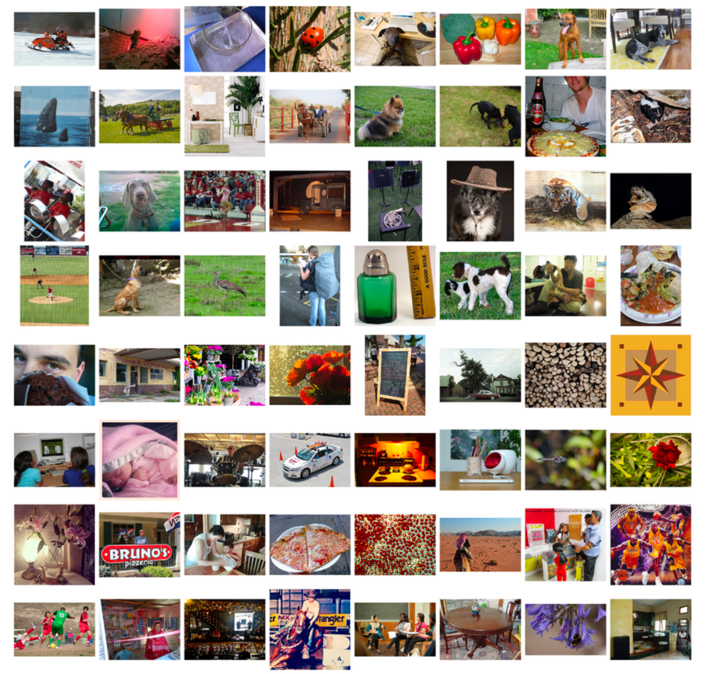 

Do you see any problems with that?

The problems:
1. Manual annotation done by humans
2. Need for large dataset of examples
3. Is that the way we, humans think?

Getting back to the ImageNet:

In 2012 Alex Krizhevsky with his team designed a network that outclassed the competition. The network achieved a top-5 error of 15.3%, around 11 percentage points lower than that next best one. This is crazy for ML standards, as you are probably aware. 

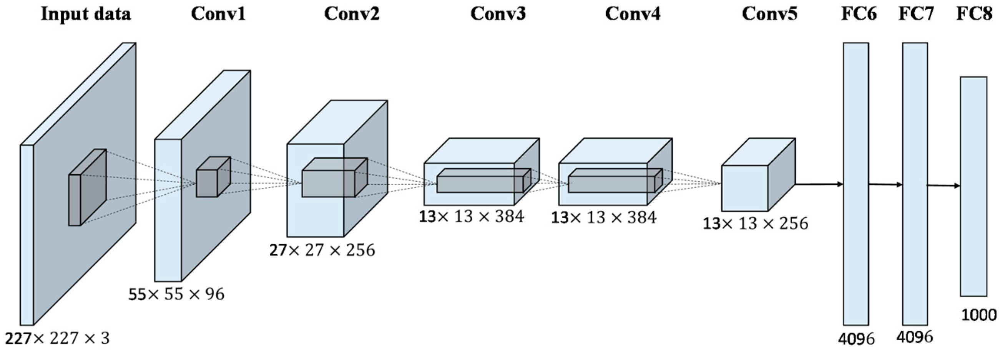

Deep dive into AlexNet: https://www.youtube.com/watch?v=7LQSdPjWjdA  
The AlexNet code example: https://github.com/krishnaik06/Advanced-CNN-Architectures/blob/master/Transfer%20Learning%20Alexnet.ipynb  
The actual paper (worth looking into for those of you who are interested): https://proceedings.neurips.cc/paper/2012/file/c399862d3b9d6b76c8436e924a68c45b-Paper.pdf   

# How does a computer see an image?

For a computer, an image is just a tensor of numbers (Class 1): **height × width × channels**. A grayscale MNIST digit is 28×28×1, a colour photo is e.g. 180×180×3 (red, green, blue), each value between 0 and 255.

## Why not just use Dense layers?

We did that in Class 1 with MNIST – flatten the image to a vector of 784 numbers and feed it to `Dense` layers. It works for tiny digits, but for real photos it breaks down:

1. **Way too many weights.** A 180×180×3 photo is 97 200 numbers. One `Dense(512)` layer on top of it needs ~50 million weights – for the first layer alone. With 2 000 training pictures, that's a recipe for overfitting.
2. **No idea of "where".** Flattening throws away the 2D structure: the network doesn't know that two pixels are neighbours.
3. **No reuse.** A cat's ear in the top-left corner and the same ear in the bottom-right corner are completely different inputs for a Dense layer. It has to learn "ear" separately for every possible position.

What we want is a layer that looks at **small local patches** and **reuses the same detector everywhere** in the image. That's a convolution.

# So what is this convolution?

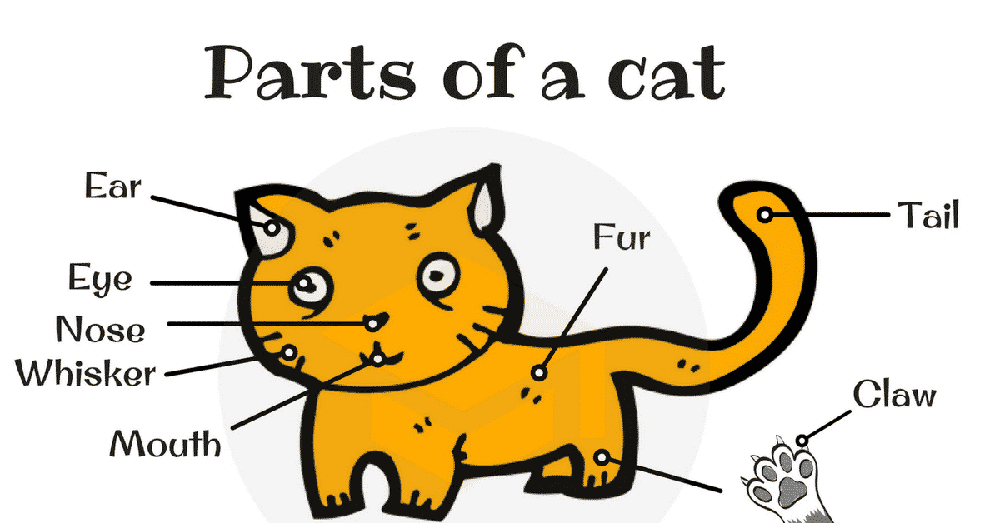

## The filter

A convolution uses a small **filter** (also called a *kernel*) – for example a 3×3 grid of weights. The filter **slides over the image**, and at every position it computes a dot product between its weights and the 3×3 patch of pixels underneath (multiply element by element, then add everything up). Each result becomes one pixel of the output, the **feature map**:

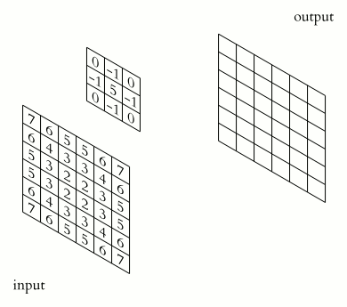

<sub>Image: Michael Plotke, [CC BY-SA 3.0](https://creativecommons.org/licenses/by-sa/3.0/), via [Wikimedia Commons](https://commons.wikimedia.org/wiki/File:2D_Convolution_Animation.gif)</sub>

What does a filter detect? Take this one:

```
 1  0  -1
 1  0  -1
 1  0  -1
```

On a flat area (all pixels similar) the left and right columns cancel out → the result is ~0. Where there's a **vertical edge** – bright on the left, dark on the right – the result is large. So this filter is a *vertical edge detector*: its feature map lights up wherever there's a vertical edge in the image.

The magic of deep learning: **we don't design the filters by hand.** The filter weights are learned by backpropagation, like any other weights. The network discovers by itself which patterns are useful.

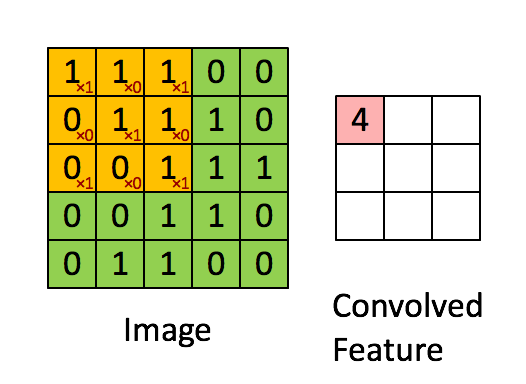

## Many filters, many feature maps

A convolution layer has many filters (e.g. `Conv2D(32, 3)` = 32 filters of size 3×3), and each produces its own feature map. So the output is again a 3D tensor: height × width × 32 – one "channel" per detected pattern.

ConvNet can recognize a pattern anywhere, because of the filter it uses. A densely connected model would have to learn the pattern every time if it is being seen in a new location. Filter allows the patterns to move. This property is called **translation invariance**, and it's exactly what we wanted.

Convolutions operate over rank-3 tensors, called feature maps. They have width, height and a number of channels. As the network goes on, the number of channels usually increases, and the width and height decrease. 

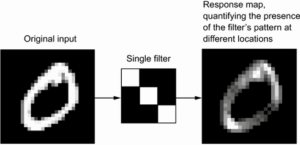
Source: https://www.manning.com/books/deep-learning-with-python 

## From edges to cats: the hierarchy

Stack convolution layers and something beautiful happens:

1. **First layers** learn simple things: edges, colours, simple textures.
2. **Middle layers** combine them into patterns: corners, circles, fur, stripes, eyes.
3. **Deep layers** combine *those* into object parts and objects: an ear, a face, a wheel, a cat.

Each layer works on the feature maps of the previous one, so it "sees" patterns of patterns. That's the picture of the cat's parts above – and it's the reason it's called *deep* learning.

More on convolution: https://www.youtube.com/watch?v=YRhxdVk_sIs  
And deeper (you get the joke): https://www.youtube.com/watch?v=m8pOnJxOcqY  

Awesome visualisation of ConvNet vs. Feedforward network on MNIST: https://adamharley.com/nn_vis/ 

## And padding?  

A 3×3 filter can't be centred on the pixels at the very edge of an image, so by default (`padding="valid"`) the output is a bit smaller than the input: a 28×28 image gives a 26×26 feature map.

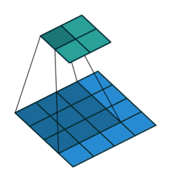

<sub>Blue: input, cyan: output. Image: Vincent Dumoulin, Francesco Visin, [MIT License](https://github.com/vdumoulin/conv_arithmetic/blob/master/LICENSE), via [Wikimedia Commons](https://commons.wikimedia.org/wiki/File:Convolution_arithmetic_-_No_padding_no_strides.gif)</sub>

With `padding="same"` Keras adds a border of zeros around the image, so the output keeps the input size and the edge pixels get as much attention as the centre ones.

## And stride?

The **stride** is how many pixels the filter moves at each step. Stride 1 looks at every position; stride 2 skips every other one and halves the width and height. Here padding and stride 2 together:

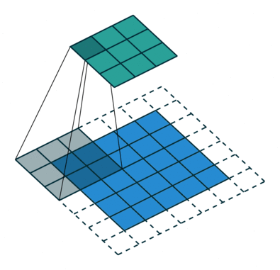

<sub>Image: Vincent Dumoulin, Francesco Visin, [MIT License](https://github.com/vdumoulin/conv_arithmetic/blob/master/LICENSE), via [Wikimedia Commons](https://commons.wikimedia.org/wiki/File:Convolution_arithmetic_-_Padding_strides.gif)</sub>

In practice we usually keep stride 1 in convolutions and leave the downsampling to MaxPooling.

## How many weights?

`filter_height × filter_width × input_channels × filters (+ filters for the biases)`. A `Conv2D(32, 3)` on a grayscale image has 3·3·1·32 + 32 = 320 weights – **no matter how big the image is**. Compare that with the 50 million of a single Dense layer above. That's why convnets are so much cheaper on images.

# And now into MaxPooling

In short - downsampling  
For:
1. Efficiency of processing
2. Efficiency of memory
3. Keeping the most important parts of each section

MaxPooling takes small windows (usually 2×2) and keeps only the **largest value** of each, halving the width and height:

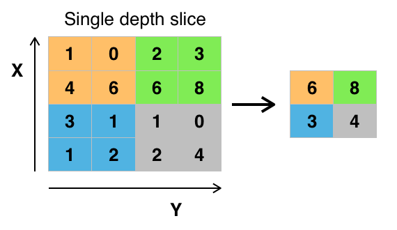

<sub>Image: Aphex34, [CC BY-SA 4.0](https://creativecommons.org/licenses/by-sa/4.0/), via [Wikimedia Commons](https://commons.wikimedia.org/wiki/File:Max_pooling.png)</sub>

Why the maximum? A feature map says "how strongly is my pattern present here". The max keeps the answer *"the pattern is somewhere in this area"* and drops the exact position – which makes the network more robust to small shifts.

There's a second, less obvious benefit: after pooling, a 3×3 filter in the next layer covers a **larger area of the original image**. This area is called the **receptive field**. Conv + pool, again and again, lets deep layers see big parts of the image – that's how the hierarchy from edges to whole objects becomes possible.

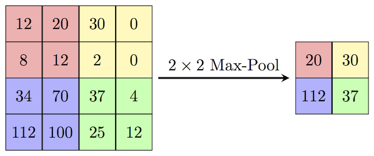

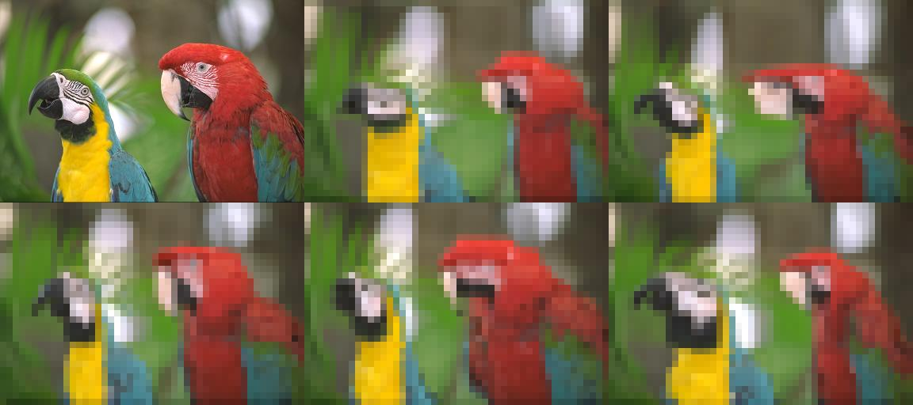

MaxPooling: https://www.youtube.com/watch?v=ZjM_XQa5s6s  

# Putting it together: a typical convnet

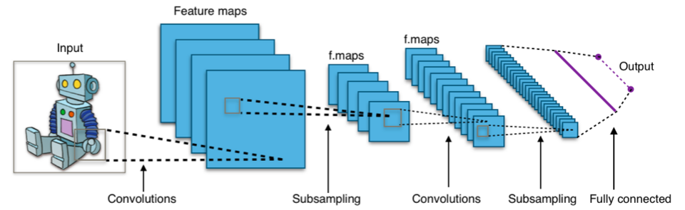

<sub>Image: Aphex34, [CC BY-SA 4.0](https://creativecommons.org/licenses/by-sa/4.0/), via [Wikimedia Commons](https://commons.wikimedia.org/wiki/File:Typical_cnn.png)</sub>

The recipe is always the same:
1. **[Conv → ReLU → MaxPooling] × N** – the **feature extractor**: the images get smaller, the number of channels (patterns) grows.
2. **Flatten** – turn the last feature maps into a vector.
3. **Dense layers** – the **classifier** on top, with the right last layer and loss for your problem (the cheat sheet from Class 2 still applies!).

The MNIST convnet from the notebook, with the shapes:

```python
inputs = keras.Input(shape=(28, 28, 1))
x = layers.Conv2D(32, 3, activation="relu")(inputs)    # → 26 × 26 × 32
x = layers.MaxPooling2D(2)(x)                          # → 13 × 13 × 32
x = layers.Conv2D(64, 3, activation="relu")(x)         # → 11 × 11 × 64
x = layers.MaxPooling2D(2)(x)                          # →  5 ×  5 × 64
x = layers.Conv2D(128, 3, activation="relu")(x)        # →  3 ×  3 × 128
x = layers.Flatten()(x)                                # → 1152
outputs = layers.Dense(10, activation="softmax")(x)    # → 10 classes
```

It reaches ~99% test accuracy on MNIST – better than the Dense network from Class 1, with far fewer weights.

# Now back to AlexNet!

What did AlexNet do that made it so revolutionary? Convnets themselves weren't new – Yann LeCun's LeNet read handwritten digits for banks already in the 1990s. AlexNet was the same idea, much bigger, with a few key tricks:

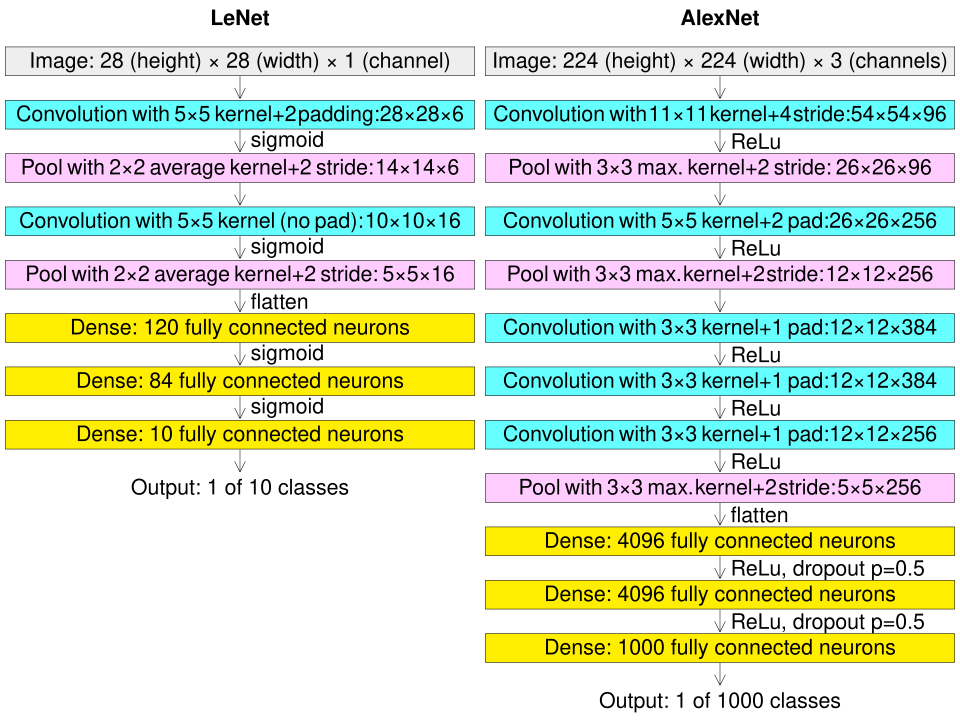

<sub>LeNet (left) vs. AlexNet (right). Image: Cmglee, [CC BY-SA 4.0](https://creativecommons.org/licenses/by-sa/4.0/), via [Wikimedia Commons](https://commons.wikimedia.org/wiki/File:Comparison_image_neural_networks.svg)</sub>

1. Data augmentation

With 60 million weights and "only" 1.2 million images, AlexNet would overfit. So every training image was randomly cropped, flipped and slightly changed in colour – the network practically never saw exactly the same picture twice. It's like getting many more training examples for free. (We do the same with `RandomFlip`, `RandomRotation`, `RandomZoom` in the notebook.)

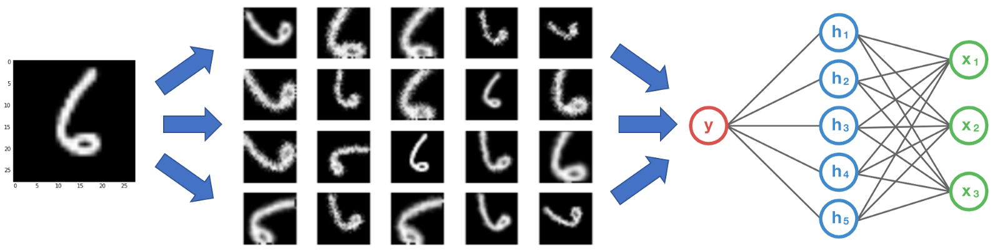

2. Dropout

During training, randomly switch off a fraction of neurons (e.g. 50%) at every step. No neuron can rely on one specific other neuron, so the network learns more robust, redundant features. At test time all neurons are used. Another weapon against overfitting.

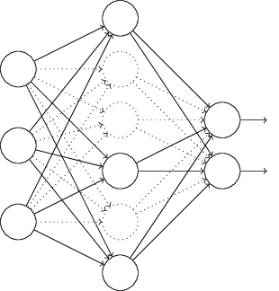

3. ReLU
Performance with precision. Before AlexNet, networks used sigmoid or tanh activations. Their gradients become tiny for large inputs, so deep networks learned very slowly (*vanishing gradients*). ReLU (`max(0, x)`) has a gradient of exactly 1 for all positive inputs – AlexNet trained about 6× faster with it.

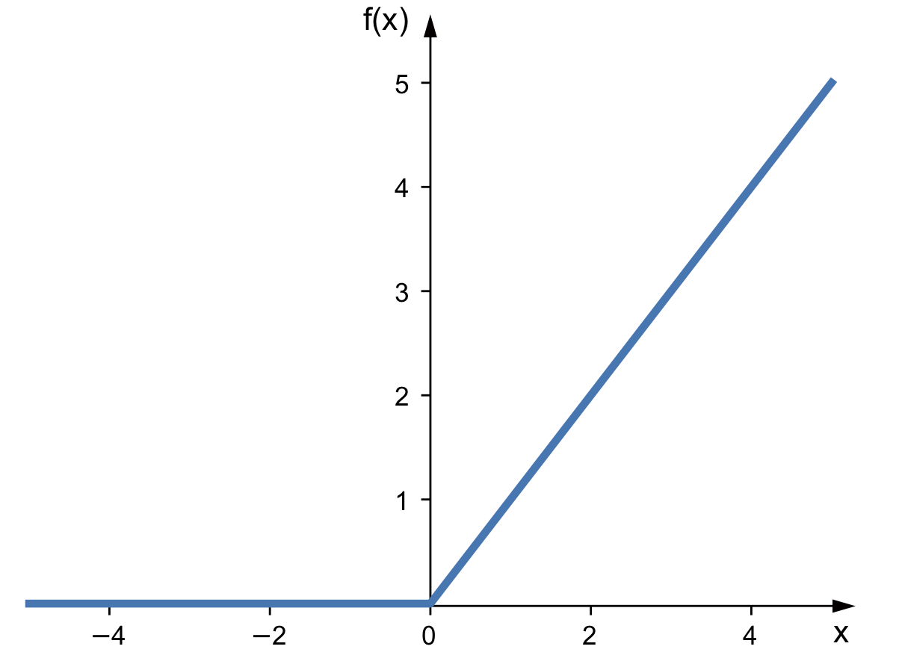

4. GPUs

AlexNet was trained on two consumer graphics cards (NVIDIA GTX 580, 3 GB each) for about a week. Training on GPUs instead of CPUs is what made a network that big possible at all – more on that next class.

# After AlexNet: a very fast decade

| Year | Architecture | The new idea |
|---|---|---|
| 1998 | LeNet-5 | Convolutions + pooling for handwritten digits |
| 2012 | AlexNet | Big convnet + ReLU + dropout + augmentation + GPUs |
| 2014 | VGG16 / VGG19 | Simplicity: only 3×3 convolutions, just many of them (we use VGG16 in the notebook) |
| 2014 | GoogLeNet (Inception) | Filters of several sizes in parallel – efficient and deep |
| 2015 | **ResNet** | **Residual connections** – made networks with 100+ layers trainable; error dropped below the estimated human error on ImageNet |
| 2019 | EfficientNet | Scale depth, width and image resolution together, in a balanced way |
| 2020 | **Vision Transformer (ViT)** | No convolutions at all – cut the image into 16×16 patches and treat them as tokens for a Transformer (Class 3!) |

**Residual connections** deserve a sentence: instead of a layer computing `y = f(x)`, it computes `y = x + f(x)` – the input is added back to the output. Gradients can then flow straight through the "+" back to early layers, so very deep networks stop being impossible to train. You've already seen this trick: it's inside every Transformer block.

**Vision Transformers** close the circle with Class 3: an image is cut into patches, each patch becomes an embedding (a "visual token"), and the same attention mechanism lets every patch look at every other patch. They need more data than convnets, but they're the vision encoders inside today's multimodal models – CLIP and the VLMs of Class 6.

# Beyond "what is in the picture?"

Classification is just the beginning. The same convnet and Transformer backbones power:
1. **Object detection** – *where* are the objects? Draw a box around every car and pedestrian (YOLO, used in cameras and self-driving cars).
2. **Segmentation** – which class does *every pixel* belong to? (U-Net in medical imaging: where exactly is the tumour?)
3. **Image generation** – diffusion models that create images from text (Class 6).

# Standing on the shoulders of giants: pretrained models

In the notebook, our convnet trained from scratch on 2 000 pictures of cats and dogs overfits quickly. Augmentation and dropout help, but the real game changer is **transfer learning**: take a network already trained on ImageNet and reuse what it learned.

The early layers of any vision network learn generic things – edges, colours, textures. Later layers learn more specific shapes. So we keep the **convolutional base** and only replace the **classifier** on top.

Two ways to do it:

1. **Feature extraction** – freeze the pretrained base (`conv_base.trainable = False`) and train only the new Dense layers. Fast, and works well with little data.
2. **Fine-tuning** – after feature extraction, unfreeze the last few layers of the base and train them together with the classifier, with a **very small learning rate** (e.g. `1e-5`). Large updates would destroy what the base already knows.

Rule of thumb: little data → feature extraction; more data, or images very different from ImageNet (X-rays, satellite images) → fine-tuning. Either way, **starting from a pretrained model is the default in practice**. Training from scratch is the exception.

It's the same idea as BERT in Class 3: someone with a lot of GPUs learns the general skill once, and everyone else adapts it cheaply.

Where to find pretrained models: [Keras Applications](https://keras.io/api/applications/), [KerasHub](https://keras.io/keras_hub/), [Hugging Face](https://huggingface.co/models).

# Your turn

In the vision notebook, try:
1. Compare test accuracy of: the convnet from scratch, with augmentation, with feature extraction, and after fine-tuning. Put them in one table.
2. Change `padding` to `"same"` in the MNIST convnet – what happens to the shapes in `model.summary()`?
3. Swap VGG16 for a newer base from Keras Applications (e.g. `EfficientNetB0`, and remember to use its own `preprocess_input`) – does it do better? Is it faster?

And without code:
1. Calculate the number of weights of `Conv2D(64, 3)` applied to a feature map with 32 channels. Compare with a `Dense(64)` on a flattened 28×28×32 input.
2. Apply the vertical edge filter from above (in your head) to a patch that is bright on the right and dark on the left. What sign does the result have?

# CGPMs and Omniglot Challenge

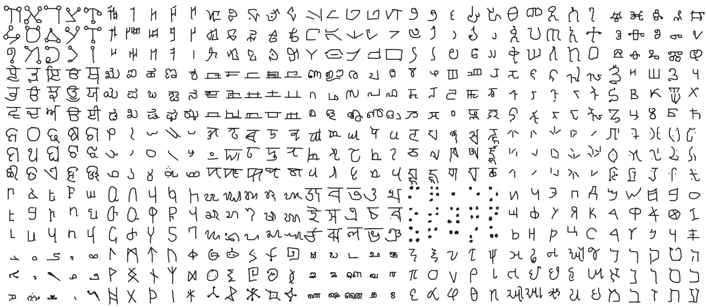

As promised here is the info about the Omniglot Dataset: https://github.com/brendenlake/omniglot  
Here the article on the Omniglot Challenge: https://arxiv.org/abs/1902.03477  
And here a good starter for CGPMs and.. what we are missing in our deep learning approach: https://link.springer.com/article/10.1007/s13218-021-00705-x  

The last article is AMAZING. It is about how do we understand thinking, human brains and what might be needed to create this sort of Strong AI (human like AI). It touches on philosophical and implementational concepts and really drives home the point about Deep Learning only scratching the surface.
