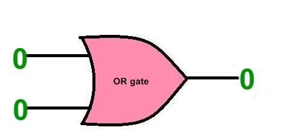
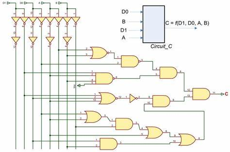
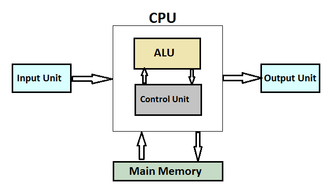
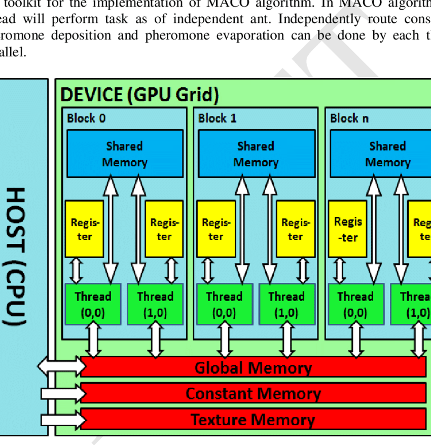
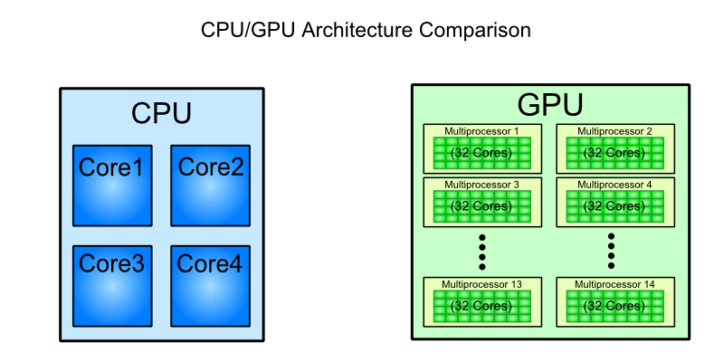
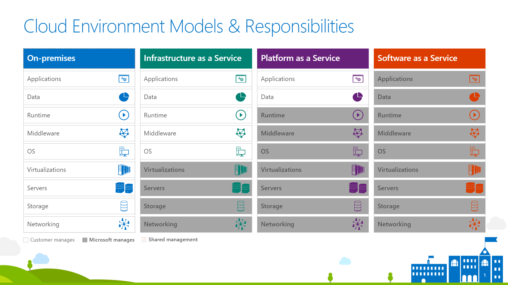
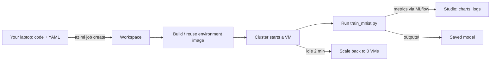

# Good evening again ^4!

So lets start with:
1. Any questions, concerns or thoughts from our last lecture? 
2. So one from me, what did we talk about last time? 
3. And, what problems do we encounter when training models for vision?

Some quick terms to repeat:
1. Convolutional Layer
2. MaxPooling Layer
3. AlexNet
4. Baseline Model

# Processing Units

What is compute power?  
What is a CPU?  

## From switches to computers

At the very bottom, a processor is made of **transistors** – tiny electrical switches (on/off, 1/0). A few transistors make a **logic gate** (AND, OR, NOT):

  

And then...  

Gates combine into circuits that add numbers, compare them, remember them:

  

Put billions of them on one chip and you get a processor. A modern laptop CPU has tens of billions of transistors; NVIDIA's H100 GPU has 80 billion.

But for us, users - this is a transparent layer. We just need an object to do something for us.  


## How do we measure "compute"?

In Deep Learning almost all the work is **multiplying and adding floating-point numbers** (remember the dot products from Class 1). So we measure compute in **FLOPS** – floating-point operations per second:

| Hardware | Roughly how fast (order of magnitude) |
|---|---|
| A laptop CPU | ~0.1–1 TFLOPS (10¹²) |
| A gaming GPU (e.g. RTX 4090) | ~80 TFLOPS in 32-bit, several hundred in 16-bit with tensor cores |
| A data-center GPU (e.g. H100) | ~1 000 TFLOPS (1 PFLOPS) in 16-bit |

To feel the scale: training GPT-3 (2020) took about 3 × 10²³ floating-point operations. On a single laptop CPU that's thousands of years; on thousands of data-center GPUs working together – a few weeks. **That gap is why hardware is a Deep Learning topic at all.**

## So what is this CPU?

  
More on how CPUs work here: https://www.youtube.com/watch?v=cNN_tTXABUA  

The **CPU** (Central Processing Unit) is the general-purpose brain of the computer. It has **a few very powerful cores** (typically 4–64), each running at 3–5 GHz, with large caches and clever tricks (predicting branches, running instructions out of order) to make **one sequence of complicated steps** finish as fast as possible. It's built for **low latency**: your operating system, browser, Excel, a Python loop full of `if`s.

CPU is a single pair of hands:
 


## And the GPU?

But what if we need multiple pairs of hands?


The **GPU** (Graphics Processing Unit) was built for computer graphics: to colour millions of pixels 60 times a second, where every pixel needs the same simple calculation. So a GPU has **thousands of small, simple cores** (an H100 has ~17 000) that all execute **the same instruction on different data** at the same time. It's built for **high throughput**: not one task fast, but a huge number of simple tasks at once.

  
More on GPUs: https://www.youtube.com/watch?v=LfdK-v0SbGI 

Parallelism is the core of GPU. We have a lot of hands but these are smaller and less complex hands. Actually GPU cannot do anything that CPU cannot do. CPU just does it (usually) slower.

  

| | CPU | GPU |
|---|---|---|
| Cores | Few (4–64), powerful | Thousands, simple |
| Optimized for | Latency – one complicated task, fast | Throughput – many simple tasks, together |
| Good at | Branching logic, operating system, data loading, preprocessing | Matrix multiplications, convolutions, graphics |
| Memory | System RAM (large, slower) | Its own VRAM (smaller, much faster) |
| In Deep Learning | Prepares data, runs the training loop | Does the heavy maths |

## Why does Deep Learning love GPUs so much?

Remember Class 1: a Dense layer is a matrix multiplication, `output = relu(dot(input, W) + b)`. Every element of the result can be computed independently – thousands of small, identical multiply-and-add operations. That's exactly the "many small hands" job a GPU was built for.

A quick count: our MNIST network from Class 1 has a `Dense(512)` layer on 784 inputs. For one batch of 128 images that's 128 × 784 × 512 ≈ **51 million** multiply-adds – for one layer, one batch, forward pass only. Training repeats it (plus the backward pass) hundreds of times per epoch. A CPU does these in small groups; a GPU does them in one go.

Modern GPUs go one step further: **tensor cores** – special units that multiply whole small matrices in one step, in lower precision (16-bit or even 8-bit numbers). That's where the huge FLOPS numbers in the table come from.

## The hidden bottleneck: memory

Compute is only half the story. The numbers have to **get to** the cores, and memory is often the real limit:

1. **Memory size (VRAM).** The whole model, the batch of data, and for training also the gradients and optimizer state must fit into GPU memory. A rule of thumb for a model with *N* parameters:
   - just to **run** it in 16-bit precision: ~2 bytes × *N* → a 7-billion-parameter LLM needs ~14 GB,
   - to **train** it with Adam: roughly 16 bytes × *N* or more → the same 7B model needs well over 100 GB – more than any single consumer GPU has.
2. **Memory bandwidth.** How many bytes per second can be moved to the cores. An H100 moves ~3 TB/s from its memory; a typical laptop's RAM ~0.05–0.1 TB/s. When generating text with an LLM, the speed is limited mostly by bandwidth, not by FLOPS – every new token needs the whole model read from memory.
3. **Moving data between CPU and GPU** is slow (more on that in the CUDA example below). Good training code keeps data on the GPU and prepares the next batch while the current one is computing.

## Precision: fewer bits, more speed

Numbers in a computer have a fixed size:

| Format | Bits | Used for |
|---|---|---|
| float32 | 32 | The classic default for training |
| float16 / bfloat16 | 16 | Today's standard for training big models ("mixed precision") – 2× less memory, much faster on tensor cores |
| int8 / int4 | 8 / 4 | Running (inference) of LLMs on smaller hardware – "quantization". A 4-bit 7B model fits in ~4 GB, so it runs on a laptop |

Neural networks are surprisingly tolerant of less precise numbers – that's one of the main tricks that made today's large models affordable.

## Beyond GPUs

What GPU is good for (and why?):
1. Image rendering (in real time)
2. Deep Learning (https://www.youtube.com/watch?v=GRRMi7UfZHg & https://www.youtube.com/watch?v=EKD1kEMNeeU) 
3. Data mining
4. Cryptocurrency mining
5. Gaming

TPU - matrix processor, specifical for DL. Very fast matrix computation. Data flows directly from one compute unit to the next (a "systolic array"), so it needs far fewer trips to memory than a CPU or GPU. TPUs are designed by Google and available only in Google Cloud (and in Colab).

**NPU** (Neural Processing Unit) – small, energy-efficient AI accelerators built into phones and new laptops (Apple Neural Engine, Qualcomm, Intel and AMD chips). They don't train models; they **run** small ones locally – face unlock, background blur in video calls, live translation, small on-device language models.

IPU: https://www.graphcore.ai/ & https://www.eejournal.com/article/20170119-ipu/  
More on CPU, GPU, TPU: https://www.youtube.com/watch?v=6ZDoFomU10A  

| | CPU | GPU | TPU | NPU |
|---|---|---|---|---|
| Made for | Everything | Graphics, now also AI | Only neural networks | Running small AI models efficiently |
| Where | Every computer | Gaming PCs, workstations, data centers | Google Cloud | Phones, new laptops |
| Train big models? | No (too slow) | Yes – the default | Yes | No |

# CUDA 

   

Why does almost every DL framework need an **NVIDIA** GPU? Because of **CUDA** – NVIDIA's platform (since 2007) for running general-purpose code on its GPUs. TensorFlow, PyTorch and JAX use CUDA libraries (cuBLAS for matrix maths, cuDNN for neural network layers) under the hood. Almost twenty years of software built on CUDA is a big part of why NVIDIA dominates AI hardware – competitors (AMD's ROCm, Google's TPUs, Apple's Metal) have to catch up not only in chips, but in software.

CUDA intro (with GPU explanation) in 6 episodes: https://www.youtube.com/watch?v=4APkMJdiudU&list=PLC6u37oFvF40BAm7gwVP7uDdzmW83yHPe  
CUDA package installer: https://docs.nvidia.com/cuda/cuda-installation-guide-microsoft-windows/index.html  
CUDA install tutorial: https://www.tutorialspoint.com/cuda/cuda_installation.htm  

Example is in /code folder for you to [have a peek](code/cuda-example.cu).  
And if you have a GPU - give it a spin! With the CUDA toolkit installed, in the `code` folder run `make` (or directly `nvcc cuda-example.cu -o cuda-example`) and then `./cuda-example`.

What the example does, step by step:
1. Creates two vectors of ~1 million numbers in normal memory (RAM, the "host").
2. Copies them to the GPU memory (the "device") – the GPU can't read your RAM directly.
3. Launches the `add` kernel on ~1 million threads (1024 blocks × 1024 threads): each thread adds one pair of numbers, and the GPU runs thousands of them in parallel.
4. Copies the result back to RAM and checks it.

Notice that steps 2 and 4 – moving data – are often slower than the computation itself. The same is true in Deep Learning: a slow data pipeline can leave an expensive GPU waiting.

So how big should my rented apartment be to fit in all the cores?  


A single data-center GPU costs tens of thousands of dollars, needs serious power and cooling, and you'd use it maybe a few hours a week. Training a big model needs thousands of them, connected with very fast networks. That's why:  


# Cloud in general and Azure in particular

**Cloud computing** = renting computers (and services built on them) from someone else's data center, over the internet, and paying only for what you use.

## Why use the cloud for Deep Learning?

1. **Hardware you couldn't buy.** A GPU cluster for a few hours instead of a six-figure investment.
2. **Elasticity.** Need 1 machine today and 50 tomorrow? Scale up, then back down to zero.
3. **Pay per use.** Per second / per hour of compute, per GB of storage, per token of a language model.
4. **Managed services.** Someone else installs drivers, patches servers, keeps backups – you focus on the model.
5. **Close to the data.** Big datasets often already live in the cloud; moving terabytes to your laptop isn't an option.

And the downsides you should know about:
1. **Cost surprises.** A forgotten GPU machine runs (and bills) all weekend.
2. **Quotas.** New accounts can rent only a little – especially GPUs (we hit this ourselves, see the hands-on below).
3. **Data protection and regulation.** Where is the data physically stored? For personal data in the EU (GDPR) you pick EU regions – our Azure language model is deployed so that the data stays in the EU.
4. **Lock-in.** The more provider-specific services you use, the harder it is to move.

## Three levels of "someone else does it for you"

  

| Model | You get | You manage | Deep Learning example |
|---|---|---|---|
| **IaaS** – Infrastructure as a Service | Virtual machines, disks, networks | Everything from the operating system up | Rent a GPU VM, install Python and CUDA yourself, run your notebook |
| **PaaS** – Platform as a Service | A ready platform | Your code and data | **Azure Machine Learning**: managed clusters that scale to zero, experiment tracking, model deployment |
| **SaaS** / model as a service | A finished service behind an API | Only how you use it | **Azure AI Foundry / OpenAI**: send text, get an answer from a big model; ready-made vision or speech services |

The higher you go, the less work – and the less control.

## The big three

| | Microsoft Azure | Amazon Web Services | Google Cloud |
|---|---|---|---|
| ML platform | Azure Machine Learning | SageMaker | Vertex AI |
| Big models as a service | Azure AI Foundry (OpenAI, Llama, Mistral, …) | Bedrock (Claude, Llama, …) | Vertex AI (Gemini, …) |
| Special hardware | NVIDIA GPUs | NVIDIA GPUs, own Trainium/Inferentia chips | NVIDIA GPUs, **TPUs** |
| Free for students | [Azure for Students](https://azure.microsoft.com/en-us/free/students/) | AWS Educate | Google Cloud credits for education |

The concepts are the same everywhere – learn them once on one provider and you can find your way on the others.

## How you pay

1. **On-demand** – pay per hour/second, stop any time. Most flexible, most expensive.
2. **Spot / low-priority** – unused capacity at a big discount (often 60–90%), but the provider can take the machine back at short notice. Great for training **if you save checkpoints** (remember `ModelCheckpoint` from Class 4) and can resume.
3. **Reserved** – commit for 1–3 years, get a discount. For companies with steady workloads.

Rough orders of magnitude for on-demand GPU machines (prices differ by region and change often – always check the provider's pricing calculator): a small inference GPU like the T4 costs well under a dollar per hour; an A100 a few dollars per hour; an H100 machine with 8 GPUs tens of dollars per hour.

**Cost hygiene, always:** set a **budget alert**, let clusters **scale to zero**, use the smallest machine that does the job, and delete what you don't need (deleting a resource group removes everything in it).

## Free options to get a GPU for your project

Limits change often – check the current ones:

Google Colab: https://colab.research.google.com/  
Free tier: only ~2 CPU cores, but you can get a GPU (usually an NVIDIA T4). Switch it on in *Runtime → Change runtime type → T4 GPU*. Sessions disconnect after a few hours of use or when idle, so save your models to Google Drive.

Kaggle: https://www.kaggle.com/code/dansbecker/running-kaggle-kernels-with-a-gpu/notebook  
Free tier: only a few CPU cores, but around 30 hours of GPU per week (T4 or P100). Switch it on in *Settings → Accelerator*. Needs a phone-verified account. Handy if your data is already a Kaggle dataset.

More on options: https://blog.paperspace.com/gradient-kaggle-notebook-comparison/  

## Okey so now Azure!  

Azure for students: https://azure.microsoft.com/en-us/free/students/  

Services for ML and DL:


  

**Azure Databricks** is a platform for big data processing with Apache Spark – where the data for ML often gets cleaned and prepared before training.

Services using DL (how and why):


Ready-made AI services (vision, speech, translation, document reading) are deep learning models trained by Microsoft that you call through an API – no training needed. Use them when your problem is a standard one ("read the text from this invoice"); train your own model when it isn't.

# Hands-on: Azure Machine Learning

Let's stop talking about the cloud and use it. Everything below lives in the [`code/azure-ml`](code/azure-ml) folder and runs in a real Azure subscription.

## The building blocks

| Thing | What it is | Analogy |
|---|---|---|
| **Resource group** | A folder for everything that belongs to one project – delete it, and everything inside is gone | A project folder |
| **Azure ML workspace** | The central place for experiments, data, models and compute. Creates a storage account, a key vault and monitoring for you | Your lab |
| **Compute cluster** | A group of virtual machines that start when a job arrives and **scale down to 0** when idle – you pay only while something runs | Rented hands, by the minute |
| **Environment** | A Docker image + list of Python packages (Keras, TensorFlow, MLflow…) – the same on every machine | Your `requirements.txt`, frozen |
| **Job** | *Code + command + environment + compute*. Azure ML ships your code to the cluster, runs it, saves logs, metrics and outputs | "Run this script over there" |
| **Experiment** | A group of related jobs, so you can compare them | A folder of runs |
| **Data asset / MLTable** | A versioned pointer to data in the cloud | A dataset with a version number |
| **Azure AI Foundry** | The service where you deploy and call large models (GPT, Llama, Mistral…) through an API | Class 6, as a service |

What happens when you submit a job:



Your training script barely changes: it reads its hyperparameters from the command line and logs metrics with [MLflow](https://mlflow.org/) – Azure ML collects them automatically. The same script runs on your laptop too.

## What we run today

1. **The Class 1 MNIST network as a cloud job** – [`train_mnist.py`](code/azure-ml/src/train_mnist.py) + [`job-mnist-cpu.yml`](code/azure-ml/job-mnist-cpu.yml). Watch the loss and accuracy curves appear in the studio while it trains.
2. **A hyperparameter sweep** – [`sweep-mnist.yml`](code/azure-ml/sweep-mnist.yml) runs 12 versions of the same script with different learning rates, layer sizes, dropout and batch sizes, 4 at a time, and picks the best by validation accuracy. The experiments notebook from Class 2, automated and in parallel.
3. **AutoML** – [`automl-housing.yml`](code/azure-ml/automl-housing.yml): give Azure ML the California housing data (prepared by [`prepare_automl_data.py`](code/azure-ml/prepare_automl_data.py)) and a metric, and it tries gradient boosting, random forests, linear models, ensembles… with automatic preprocessing, and ranks them. **Same data and same split as the Class 3 challenge** – did your network beat AutoML's mean absolute error?
4. **A large language model as a service** – [`foundry-chat.ipynb`](code/azure-ml/foundry-chat.ipynb): call `gpt-4.1-mini` in Azure AI Foundry, see the token costs, streaming and tool calling (the agent harness from Class 6, with a big model). [](https://colab.research.google.com/github/pamelon/DeepLearning-ALK/blob/main/Classes/Class-5/code/azure-ml/foundry-chat.ipynb)

The commands, if you have your own Azure subscription (the [Azure for Students](https://azure.microsoft.com/en-us/free/students/) credit is enough):

```bash
az login
az extension add --name ml
az ml workspace create --name my-ws --resource-group my-rg --location northeurope
az ml compute create --name cpu-cluster --type AmlCompute --size Standard_E4s_v3 --min-instances 0 --max-instances 4 --workspace-name my-ws --resource-group my-rg
az ml environment create --file environments/keras-cpu.yml --workspace-name my-ws --resource-group my-rg
az ml job create --file job-mnist-cpu.yml --workspace-name my-ws --resource-group my-rg --stream
```

## Cloud lessons from setting this up

1. **Quotas are real.** A new subscription can rent only a few CPU cores per region and usually **zero GPUs** – you have to request a quota increase and wait. That's why our GPU job ([`job-mnist-gpu.yml`](code/azure-ml/job-mnist-gpu.yml)) is ready but not running – compare CPU vs. GPU in Colab instead.
2. **Scale to zero.** A cluster with `min-instances 0` costs nothing while idle. A forgotten GPU VM running over a weekend costs more than your phone bill.
3. **The first run is slow.** Building the environment image takes 10–15 minutes; later runs reuse it and start in a minute or two.
4. **No keys in code.** We log in with `az login` and use roles (Entra ID) instead of pasting API keys into notebooks – keys in a public repo get stolen within minutes.
5. **Clean up.** When the course ends: `az group delete --name <resource-group>` removes everything at once.

# Do I have a GPU?

You don't need to write CUDA to use a GPU in Deep Learning – TensorFlow, PyTorch and JAX do it for you. Check what they see:

```python
import tensorflow as tf
print(tf.config.list_physical_devices("GPU"))   # [] means: CPU only
```

```python
import torch
print(torch.cuda.is_available())
```

```python
import jax
print(jax.devices())   # [CpuDevice(id=0)] means: CPU only
```

If the GPU is there, Keras uses it automatically. A few tips to make it actually fast:
1. **Bigger batches** – a GPU likes to get a lot of work at once. Try 64–256 instead of 32 (and adjust the learning rate if needed).
2. **Feed it fast** – with `tf.data`, add `.cache()` and `.prefetch(tf.data.AUTOTUNE)` so the next batch is ready while the current one is computing.
3. **Mixed precision** – `keras.mixed_precision.set_global_policy("mixed_float16")` computes in 16-bit floats on modern GPUs: often ~2× faster and half the memory.
4. **Out of memory?** – reduce the batch size first, then the model size.

# Frameworks: TensorFlow, PyTorch and JAX

So far we have used Keras on top of TensorFlow. But there are three big engines in Deep Learning today, and since **Keras 3** you can run the same Keras code on any of them.

| | TensorFlow | PyTorch | JAX |
|---|---|---|---|
| From | Google (2015) | Meta (2016) | Google (2018) |
| Style | Layers, graphs, `tf.data` pipelines | Python objects, "just write the loop" | NumPy + function transformations (`grad`, `jit`, `vmap`) |
| Strong in | Production, mobile and web deployment | Research, most open-source models (Hugging Face) | Large-scale training, TPUs, research at Google DeepMind |
| Libraries on top | Keras | torchvision, Lightning, Hugging Face | Keras, Flax, Optax |

**What makes JAX different?** It's NumPy that runs on CPU, GPU and TPU, plus a few *transformations* you apply to your own Python functions:
1. `jax.grad(f)` – returns a new function that computes the gradient of `f` (remember `GradientTape` from Class 1?).
2. `jax.jit(f)` – compiles `f` with XLA into one fast fused program for the accelerator.
3. `jax.vmap(f)` – turns a function written for **one** example into one that runs on a whole batch, without loops.

The price: JAX wants **pure functions** – no hidden state, no modifying arrays in place, explicit random keys. That feels strict at first, but it's exactly what makes compiling and parallelizing across many chips so easy – and why many of the largest models are trained with it.

## Keras vs. PyTorch vs. JAX – what's actually different?

First, an important detail: **Keras is not a fourth engine.** It's a high-level API that sits *on top of* TensorFlow, PyTorch or JAX. So the real comparison is about **how much you write yourself**:

```
   you write less ◄──────────────────────────────────────► you write more
   Keras                      PyTorch                       JAX
   model.fit() does it all    you write the training loop   you write the loop AND manage
                                                            the parameters yourself
```

### The same model, three ways

A 2-layer network for MNIST, trained for one epoch.

**Keras** – describe the model, call `fit()`:

```python
model = keras.Sequential([
    keras.Input(shape=(784,)),
    keras.layers.Dense(512, activation="relu"),
    keras.layers.Dense(10, activation="softmax"),
])
model.compile(optimizer="adam", loss="sparse_categorical_crossentropy", metrics=["accuracy"])
model.fit(x_train, y_train, epochs=1, batch_size=128)
```

**PyTorch** – the model is a Python object that *holds* its weights, and you write the loop:

```python
model = nn.Sequential(nn.Linear(784, 512), nn.ReLU(), nn.Linear(512, 10))
optimizer = torch.optim.Adam(model.parameters())
loss_fn = nn.CrossEntropyLoss()        # takes raw scores (logits), softmax is inside

for images, labels in train_loader:    # one epoch
    optimizer.zero_grad()              # 1. reset old gradients
    loss = loss_fn(model(images.view(-1, 784)), labels)
    loss.backward()                    # 2. compute gradients
    optimizer.step()                   # 3. update the weights
```

**JAX** – the model is a *pure function*; the weights are just data you pass in and get back:

```python
def model(params, x):
    x = jax.nn.relu(x @ params["w1"] + params["b1"])
    return x @ params["w2"] + params["b2"]

def loss_fn(params, x, y):
    logits = model(params, x)
    return optax.softmax_cross_entropy_with_integer_labels(logits, y).mean()

optimizer = optax.adam(1e-3)
opt_state = optimizer.init(params)

@jax.jit                                # compile the whole training step
def train_step(params, opt_state, x, y):
    grads = jax.grad(loss_fn)(params, x, y)
    updates, opt_state = optimizer.update(grads, opt_state)
    return optax.apply_updates(params, updates), opt_state

for x, y in batches:                    # one epoch
    params, opt_state = train_step(params, opt_state, x, y)
```

(`optax` is the optimizer library for JAX, `pip install optax`; in real projects you'd also use Flax for layers instead of writing `x @ w + b` by hand.)

### The differences in one table

| | Keras | PyTorch | JAX |
|---|---|---|---|
| What it is | High-level API on top of TF / PyTorch / JAX | Full framework | Array library + function transformations |
| Who writes the training loop | Keras (`fit()`) – you can override it | You | You |
| Where the weights live | Inside layers, managed for you | Inside `nn.Module` objects (mutable state) | Outside the model, in a dict you pass around (no hidden state) |
| How gradients work | Automatic inside `fit()` | `loss.backward()` fills `.grad` on every parameter | `jax.grad(f)` returns a new function |
| Execution | Compiled automatically when possible | Eager by default (runs line by line), `torch.compile` to speed up | Eager for debugging, `jax.jit` to compile with XLA |
| Debugging | Easy for standard models, harder inside custom parts | Easiest – it's just Python, `print` anything | Harder inside `jit` (tracers, not values) |
| Randomness | Seeds (`keras.utils.set_random_seed`) | Global seed (`torch.manual_seed`) | Explicit keys passed around (`jax.random.key`) |
| Best for | Learning, fast prototyping, standard architectures, switching backends | Research, most open-source models, Hugging Face ecosystem | Large-scale training, TPUs, custom math and research |

### So which one should you pick?

1. **Learning DL or building a standard model** → Keras. You focus on the problem, not the plumbing.
2. **You want to use a model from Hugging Face or a paper's code** → PyTorch – that's where most of them are.
3. **You need maximum speed on TPUs, or unusual math (per-example gradients, physics, custom optimizers)** → JAX.

For your course project: honestly – the one you'll debug fastest. Start with Keras; switching its backend is one line:

```python
import os
os.environ["KERAS_BACKEND"] = "jax"   # or "tensorflow", "torch" – before the first `import keras`
import keras
```

Notebooks for today:
1. [JAX intro – `jax.numpy`, `grad`, `jit`, `vmap` and Keras on the JAX backend](code/jax-intro.ipynb) [](https://colab.research.google.com/github/pamelon/DeepLearning-ALK/blob/main/Classes/Class-5/code/jax-intro.ipynb)
2. [PyTorch intro – the same MNIST network, written the PyTorch way](code/pytorch-intro.ipynb) [](https://colab.research.google.com/github/pamelon/DeepLearning-ALK/blob/main/Classes/Class-5/code/pytorch-intro.ipynb)

# Your turn

1. Run `tf.config.list_physical_devices("GPU")` on your laptop and in Colab with a GPU runtime.
2. Take the dogs vs. cats convnet from Class 4 and time one epoch on CPU vs. on a Colab GPU. How big is the difference?
3. On the GPU, try batch sizes 32, 128 and 512 – what happens to the time per epoch and to the accuracy?
4. In the JAX notebook, compare the time of the function with and without `jax.jit`. Then run it on a Colab GPU or TPU runtime.
5. Train the MNIST model from the JAX notebook with `KERAS_BACKEND` set to `"jax"`, `"tensorflow"` and `"torch"` (restart the kernel each time). Same results? Same speed?
