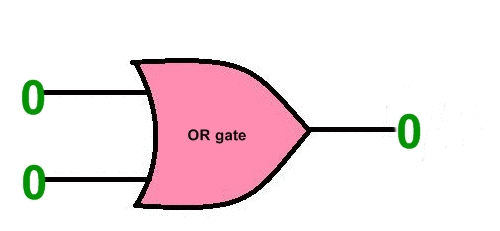
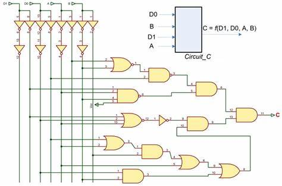
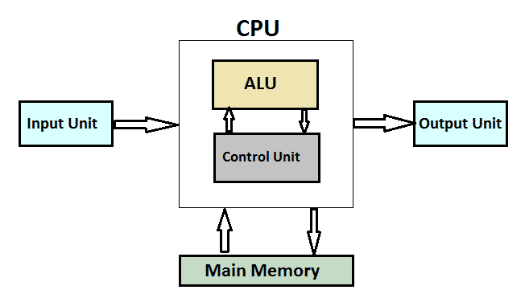
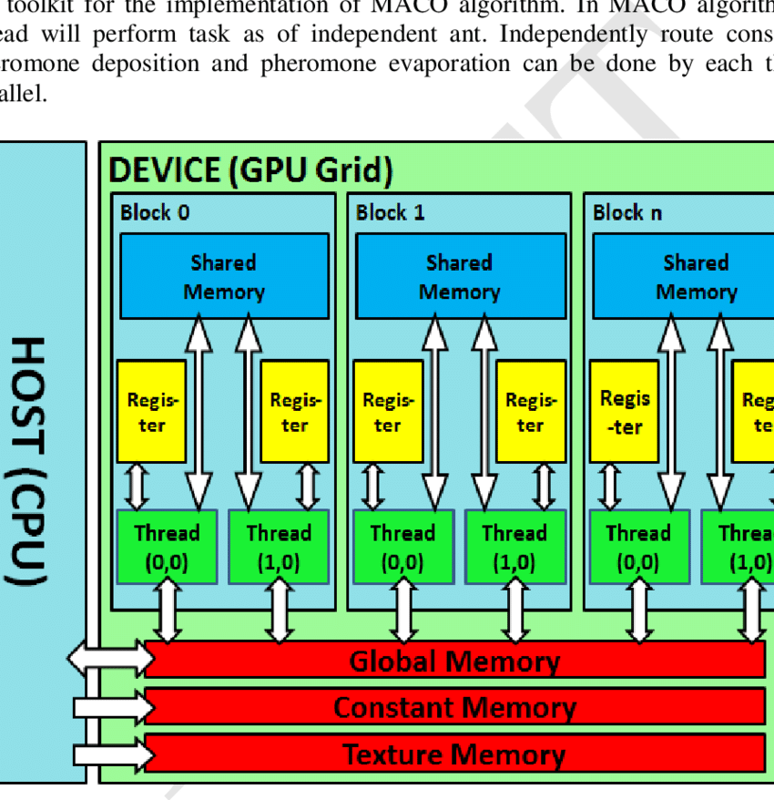
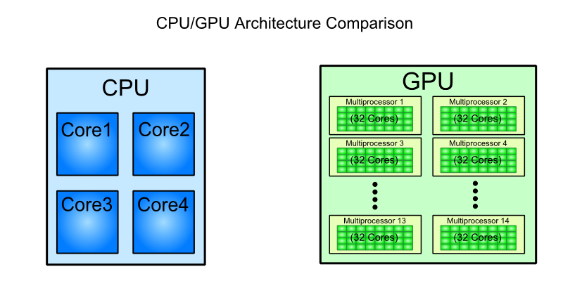
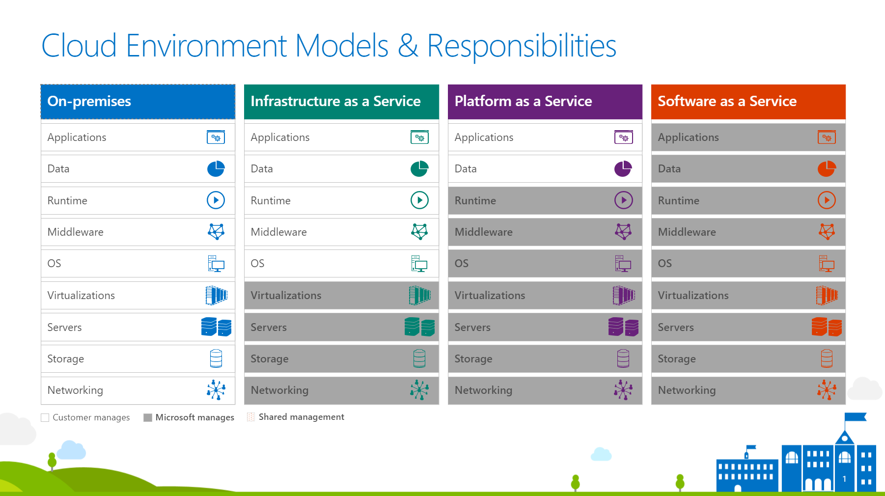

# Good evening again ^4!

So lets start with:
1. Any questions, concerns or thoughts from our last lecture? 
2. So one from me, what did we talk about last time? 
3. And, what problems do we encounter when training models for vision?

Some quick terms to repeat:
1. Convolutional Layer
2. MaxPooling Layer
3. AlexNet
4. Baseline Model

# Processing Units

What is compute power?  
What is a CPU?  

  

And then...  

  

But for us, users - this is a transparent layer. We just need an object to do something for us.  


So what is this CPU?

  
More on how CPUs work here: https://www.youtube.com/watch?v=cNN_tTXABUA  

CPU is a single pair of hands:
 


But what if we need multiple pairs of hands?


  
More on how GPUs work here: https://www.youtube.com/watch?v=SrAMBi_8tIk
Even more on GPUs: https://www.youtube.com/watch?v=LfdK-v0SbGI 

Parallelism is the core of GPU. We have a lot of hands but these are smaller and less complex hands. Actually GPU cannot do anything that CPU cannot do. CPU just does it (usually) slower.

  

What GPU is good for (and why?):
1. Image rendering (in real time)
2. Deep Learning (https://www.youtube.com/watch?v=GRRMi7UfZHg & https://www.youtube.com/watch?v=EKD1kEMNeeU) 
3. Data mining
4. Cryptocurrency mining
5. Gaming

TPU - matrix processor, specifical for DL. Very fast matrix computation. Data flows directly from one compute unit to the next (a "systolic array"), so it needs far fewer trips to memory than a CPU or GPU.  

Why does Deep Learning love GPUs so much? Remember Class 1: a Dense layer is a matrix multiplication, `output = relu(dot(input, W) + b)`. Every element of the result can be computed independently – thousands of small, identical multiply-and-add operations. That's exactly the "many small hands" job a GPU was built for.

IPU: https://www.graphcore.ai/ & https://www.eejournal.com/article/20170119-ipu/  
More on CPU, GPU, TPU: https://www.youtube.com/watch?v=6ZDoFomU10A  

# CUDA 

   
CUDA intro (with GPU explanation) in 6 episodes: https://www.youtube.com/watch?v=4APkMJdiudU&list=PLC6u37oFvF40BAm7gwVP7uDdzmW83yHPe  
CUDA package installer: https://docs.nvidia.com/cuda/cuda-installation-guide-microsoft-windows/index.html  
CUDA install tutorial: https://www.tutorialspoint.com/cuda/cuda_installation.htm  

Example is in /code folder for you to [have a peek](code/cuda-example.cu).  
And if you have a GPU - give it a spin! With the CUDA toolkit installed, in the `code` folder run `make` (or directly `nvcc cuda-example.cu -o cuda-example`) and then `./cuda-example`.

What the example does, step by step:
1. Creates two vectors of ~1 million numbers in normal memory (RAM, the "host").
2. Copies them to the GPU memory (the "device") – the GPU can't read your RAM directly.
3. Launches the `add` kernel on ~1 million threads (1024 blocks × 1024 threads): each thread adds one pair of numbers, and the GPU runs thousands of them in parallel.
4. Copies the result back to RAM and checks it.

Notice that steps 2 and 4 – moving data – are often slower than the computation itself. The same is true in Deep Learning: a slow data pipeline can leave an expensive GPU waiting.

So how big should my rented apartment be to fit in all the cores?  


That's why:  


# Cloud in general and Azure in particular

Azure for students: https://azure.microsoft.com/en-us/free/students/  

  

Free options to get a GPU for your project (limits change often – check the current ones):

Google Colab: https://colab.research.google.com/  
Free tier: only ~2 CPU cores, but you can get a GPU (usually an NVIDIA T4). Switch it on in *Runtime → Change runtime type → T4 GPU*. Sessions disconnect after a few hours of use or when idle, so save your models to Google Drive.

Kaggle: https://www.kaggle.com/code/dansbecker/running-kaggle-kernels-with-a-gpu/notebook  
Free tier: only a few CPU cores, but around 30 hours of GPU per week (T4 or P100). Switch it on in *Settings → Accelerator*. Needs a phone-verified account. Handy if your data is already a Kaggle dataset.

More on options: https://blog.paperspace.com/gradient-kaggle-notebook-comparison/#:~:text=Kaggle%3A%20GPU%3A%20TESLA%20P100%20with%202%20CPU%20cores,with%204%20CPU%20cores%20and%2016%20GB%20RAM  

Okey so now Azure!  

Services for ML and DL:


  

Services using DL (how and why):


# Do I have a GPU?

You don't need to write CUDA to use a GPU in Deep Learning – TensorFlow, PyTorch and JAX do it for you. Check what they see:

```python
import tensorflow as tf
print(tf.config.list_physical_devices("GPU"))   # [] means: CPU only
```

```python
import torch
print(torch.cuda.is_available())
```

```python
import jax
print(jax.devices())   # [CpuDevice(id=0)] means: CPU only
```

If the GPU is there, Keras uses it automatically. A few tips to make it actually fast:
1. **Bigger batches** – a GPU likes to get a lot of work at once. Try 64–256 instead of 32 (and adjust the learning rate if needed).
2. **Feed it fast** – with `tf.data`, add `.cache()` and `.prefetch(tf.data.AUTOTUNE)` so the next batch is ready while the current one is computing.
3. **Mixed precision** – `keras.mixed_precision.set_global_policy("mixed_float16")` computes in 16-bit floats on modern GPUs: often ~2× faster and half the memory.
4. **Out of memory?** – reduce the batch size first, then the model size.

# Frameworks: TensorFlow, PyTorch and JAX

So far we have used Keras on top of TensorFlow. But there are three big engines in Deep Learning today, and since **Keras 3** you can run the same Keras code on any of them.

| | TensorFlow | PyTorch | JAX |
|---|---|---|---|
| From | Google (2015) | Meta (2016) | Google (2018) |
| Style | Layers, graphs, `tf.data` pipelines | Python objects, "just write the loop" | NumPy + function transformations (`grad`, `jit`, `vmap`) |
| Strong in | Production, mobile and web deployment | Research, most open-source models (Hugging Face) | Large-scale training, TPUs, research at Google DeepMind |
| Libraries on top | Keras | torchvision, Lightning, Hugging Face | Keras, Flax, Optax |

**What makes JAX different?** It's NumPy that runs on CPU, GPU and TPU, plus a few *transformations* you apply to your own Python functions:
1. `jax.grad(f)` – returns a new function that computes the gradient of `f` (remember `GradientTape` from Class 1?).
2. `jax.jit(f)` – compiles `f` with XLA into one fast fused program for the accelerator.
3. `jax.vmap(f)` – turns a function written for **one** example into one that runs on a whole batch, without loops.

The price: JAX wants **pure functions** – no hidden state, no modifying arrays in place, explicit random keys. That feels strict at first, but it's exactly what makes compiling and parallelizing across many chips so easy – and why many of the largest models are trained with it.

## Keras vs. PyTorch vs. JAX – what's actually different?

First, an important detail: **Keras is not a fourth engine.** It's a high-level API that sits *on top of* TensorFlow, PyTorch or JAX. So the real comparison is about **how much you write yourself**:

```
   you write less ◄──────────────────────────────────────► you write more
   Keras                      PyTorch                       JAX
   model.fit() does it all    you write the training loop   you write the loop AND manage
                                                            the parameters yourself
```

### The same model, three ways

A 2-layer network for MNIST, trained for one epoch.

**Keras** – describe the model, call `fit()`:

```python
model = keras.Sequential([
    keras.Input(shape=(784,)),
    keras.layers.Dense(512, activation="relu"),
    keras.layers.Dense(10, activation="softmax"),
])
model.compile(optimizer="adam", loss="sparse_categorical_crossentropy", metrics=["accuracy"])
model.fit(x_train, y_train, epochs=1, batch_size=128)
```

**PyTorch** – the model is a Python object that *holds* its weights, and you write the loop:

```python
model = nn.Sequential(nn.Linear(784, 512), nn.ReLU(), nn.Linear(512, 10))
optimizer = torch.optim.Adam(model.parameters())
loss_fn = nn.CrossEntropyLoss()        # takes raw scores (logits), softmax is inside

for images, labels in train_loader:    # one epoch
    optimizer.zero_grad()              # 1. reset old gradients
    loss = loss_fn(model(images.view(-1, 784)), labels)
    loss.backward()                    # 2. compute gradients
    optimizer.step()                   # 3. update the weights
```

**JAX** – the model is a *pure function*; the weights are just data you pass in and get back:

```python
def model(params, x):
    x = jax.nn.relu(x @ params["w1"] + params["b1"])
    return x @ params["w2"] + params["b2"]

def loss_fn(params, x, y):
    logits = model(params, x)
    return optax.softmax_cross_entropy_with_integer_labels(logits, y).mean()

optimizer = optax.adam(1e-3)
opt_state = optimizer.init(params)

@jax.jit                                # compile the whole training step
def train_step(params, opt_state, x, y):
    grads = jax.grad(loss_fn)(params, x, y)
    updates, opt_state = optimizer.update(grads, opt_state)
    return optax.apply_updates(params, updates), opt_state

for x, y in batches:                    # one epoch
    params, opt_state = train_step(params, opt_state, x, y)
```

(`optax` is the optimizer library for JAX, `pip install optax`; in real projects you'd also use Flax for layers instead of writing `x @ w + b` by hand.)

### The differences in one table

| | Keras | PyTorch | JAX |
|---|---|---|---|
| What it is | High-level API on top of TF / PyTorch / JAX | Full framework | Array library + function transformations |
| Who writes the training loop | Keras (`fit()`) – you can override it | You | You |
| Where the weights live | Inside layers, managed for you | Inside `nn.Module` objects (mutable state) | Outside the model, in a dict you pass around (no hidden state) |
| How gradients work | Automatic inside `fit()` | `loss.backward()` fills `.grad` on every parameter | `jax.grad(f)` returns a new function |
| Execution | Compiled automatically when possible | Eager by default (runs line by line), `torch.compile` to speed up | Eager for debugging, `jax.jit` to compile with XLA |
| Debugging | Easy for standard models, harder inside custom parts | Easiest – it's just Python, `print` anything | Harder inside `jit` (tracers, not values) |
| Randomness | Seeds (`keras.utils.set_random_seed`) | Global seed (`torch.manual_seed`) | Explicit keys passed around (`jax.random.key`) |
| Best for | Learning, fast prototyping, standard architectures, switching backends | Research, most open-source models, Hugging Face ecosystem | Large-scale training, TPUs, custom math and research |

### So which one should you pick?

1. **Learning DL or building a standard model** → Keras. You focus on the problem, not the plumbing.
2. **You want to use a model from Hugging Face or a paper's code** → PyTorch – that's where most of them are.
3. **You need maximum speed on TPUs, or unusual math (per-example gradients, physics, custom optimizers)** → JAX.

For your course project: honestly – the one you'll debug fastest. Start with Keras; switching its backend is one line:

```python
import os
os.environ["KERAS_BACKEND"] = "jax"   # or "tensorflow", "torch" – before the first `import keras`
import keras
```

Notebooks for today:
1. [JAX intro – `jax.numpy`, `grad`, `jit`, `vmap` and Keras on the JAX backend](code/jax-intro.ipynb)
2. [PyTorch intro – the same MNIST network, written the PyTorch way](code/pytorch-intro.ipynb)

# Your turn

1. Run `tf.config.list_physical_devices("GPU")` on your laptop and in Colab with a GPU runtime.
2. Take the dogs vs. cats convnet from Class 4 and time one epoch on CPU vs. on a Colab GPU. How big is the difference?
3. On the GPU, try batch sizes 32, 128 and 512 – what happens to the time per epoch and to the accuracy?
4. In the JAX notebook, compare the time of the function with and without `jax.jit`. Then run it on a Colab GPU or TPU runtime.
5. Train the MNIST model from the JAX notebook with `KERAS_BACKEND` set to `"jax"`, `"tensorflow"` and `"torch"` (restart the kernel each time). Same results? Same speed?
