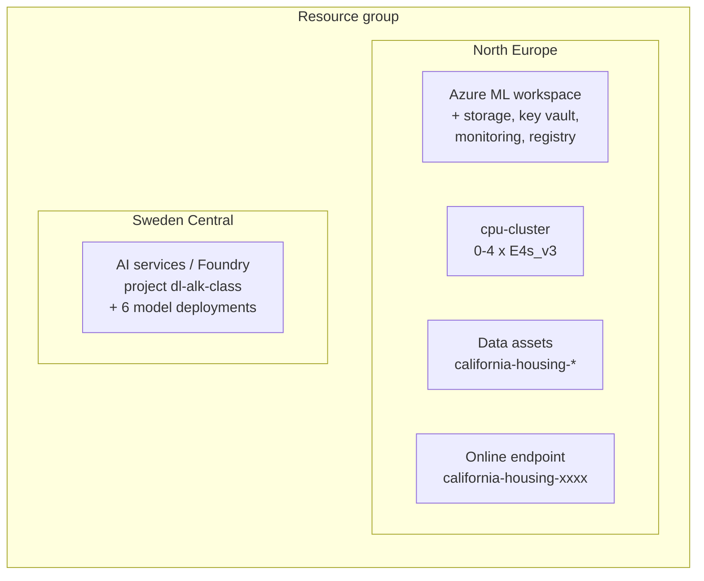

# Azure for Class 5 (and 6) – how to set it all up

Everything the class uses in Azure, as files: the experiments, the API, the AI services notebook – and two scripts that create and remove the whole infrastructure.

## What's in this folder

| File | What it is |
|---|---|
| [`setup-azure.ps1`](setup-azure.ps1) | Creates everything from scratch (see below) |
| [`teardown-azure.ps1`](teardown-azure.ps1) | Deletes the API endpoints (`-EndpointsOnly`) or the whole resource group (`-Everything`) |
| [`src/train_mnist.py`](src/train_mnist.py) | The Class 1 MNIST network as a training script, logging metrics with MLflow |
| [`environments/`](environments) | Keras + TensorFlow + MLflow environments (CPU and GPU) |
| [`job-mnist-cpu.yml`](job-mnist-cpu.yml), [`job-mnist-gpu.yml`](job-mnist-gpu.yml) | The training job on a CPU / GPU cluster |
| [`sweep-mnist.yml`](sweep-mnist.yml) | Hyperparameter sweep: 12 trials, 4 in parallel |
| [`prepare_automl_data.py`](prepare_automl_data.py) | Exports California housing to CSV + MLTable (same split as the Class 3 challenge) |
| [`automl-housing.yml`](automl-housing.yml) | AutoML regression on California housing |
| [`endpoint-housing.yml`](endpoint-housing.yml), [`deployment-housing.yml`](deployment-housing.yml) | The best AutoML model as a REST API |
| [`sample-request.json`](sample-request.json) | Three districts to send to the API |
| [`ai-services.ipynb`](ai-services.ipynb) | Ready-made AI services: Language, Translator, Vision |

## What the setup creates



| Resource | Cost |
|---|---|
| Workspace (+ storage, key vault, monitoring, container registry) | Cents to a few dollars per month |
| `cpu-cluster` | ~0.30 USD per hour **per running node**; 0 when idle (scales to 0 after 2 min) |
| Running all experiments once | ~1–2 USD |
| AI services (Language, Translator, Vision, Speech) | Per call; a class demo costs cents. Nothing when idle |
| Foundry project `dl-alk-class` + deployments (`gpt-4.1-mini`, `gpt-image-1.5`, `whisper`, `tts`, `text-embedding-3-small`, `Phi-4-mini-instruct`) | Per token / image / audio minute; one generated image is a few cents. Nothing when idle |
| **Online endpoint** | **~0.15 USD per hour, 24/7 (~3.5 USD/day) until deleted** |

Prices are rough and change – check the [Azure pricing calculator](https://azure.microsoft.com/pricing/calculator/).

## Before you start (once per computer)

1. Install the Azure CLI: `winget install Microsoft.AzureCLI`, then open a **new** PowerShell window.
2. Log in. If your tenant requires MFA, name it explicitly:
   ```powershell
   az login --tenant <your-tenant-id>
   ```
3. Python with `numpy` – only for `prepare_automl_data.py` (the setup script runs it if the data folder is missing).
4. **Antivirus that inspects HTTPS** (e.g. Norton Web Shield): the Azure CLI then fails with `CERTIFICATE_VERIFY_FAILED`. Export the antivirus root certificate from the Windows certificate store, append it to the CLI's `certifi\cacert.pem` bundle in a separate file, and point the user environment variable `REQUESTS_CA_BUNDLE` to that file.

## Set everything up

From this folder:

```powershell
cd Classes\Class-5\code\azure-ml
.\setup-azure.ps1 -ResourceGroup DL_ALK_RH                 # everything, ~1 hour (AutoML is the slow part)
.\setup-azure.ps1 -ResourceGroup DL_ALK_RH -SkipEndpoint   # everything except the 24/7 API
.\setup-azure.ps1 -ResourceGroup DL_ALK_RH -DryRun         # just print the commands
```

The script registers the resource providers, creates the resource group, workspace, cluster, environment, data assets, the Foundry resource with the project `dl-alk-class` and six model deployments (and gives your account the roles to use them without keys), submits the three experiments, waits for AutoML, registers the best model and deploys it as an API. It reuses what already exists, so you can re-run it.

Useful parameters: `-Location`, `-ClusterSize` / `-EndpointVmSize` (pick VM families you have quota for), `-FoundryLocation`, `-SkipFoundry`, `-SkipExperiments`, `-SkipEndpoint`.

At the end it prints the Foundry endpoint for the notebooks – set it before starting Jupyter (or paste it when the notebook asks):

```powershell
$env:AZURE_AI_SERVICES_ENDPOINT = "https://<your-foundry>.cognitiveservices.azure.com/"
$env:AZURE_OPENAI_ENDPOINT      = "https://<your-foundry>.cognitiveservices.azure.com/"
```

## Clean up

```powershell
.\teardown-azure.ps1 -ResourceGroup DL_ALK_RH -EndpointsOnly   # stop the 24/7 cost of the API, keep the rest
.\teardown-azure.ps1 -ResourceGroup DL_ALK_RH -Everything      # delete everything (asks you to type the name)
```

## Troubleshooting

| Problem | Why | Fix |
|---|---|---|
| `Not enough quota available for <VM>` | Quotas are per VM family and region; other jobs may be using it | Use another family (`-EndpointVmSize Standard_E2s_v3`, `-ClusterSize ...`) or request more quota (portal → *Quotas* → *Machine Learning*) |
| GPU cluster can't be created | New subscriptions usually have **0** GPU quota | Request quota for e.g. `NCASv3_T4`, or compare CPU vs. GPU in Colab |
| `SubscriptionNotRegistered` | A resource provider isn't registered | The script registers them; manually: `az provider register --namespace Microsoft.Network` (and `Microsoft.Cdn`, `Microsoft.PolicyInsights`) |
| `The feature 'Caption' is not supported in this region` | Not all AI features exist in all regions | Use tags/objects/OCR, or create the AI services resource in a region that has captions |
| `AADSTS50076` / MFA errors at login | The tenant requires multi-factor authentication | `az login --tenant <tenant-id>` |
| Deployment created but the API answers nothing | Traffic wasn't switched to the deployment (e.g. the connection dropped) | `az ml online-endpoint update --name <endpoint> --traffic "lightgbm=100" ...` |
| `ImportError: DLL load failed ... blocked` locally | Windows Smart App Control blocks unsigned Python libraries | Run the notebooks in Google Colab |
