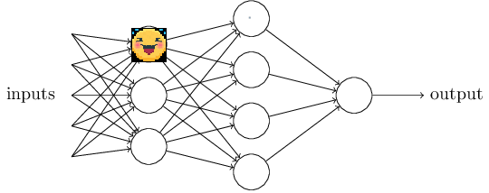

# DeepLearning-ALK

Repository with materials for 2026/27 Deep Learning courses at Koźmiński University.

## Classes

Classes are conducted onsite at Koźmiński. All classes are mandatory, one absence is allowed. As always yet, **the class is for you, not for me**. If you signed up I hope you're interested in the content.

Class dates and contents are as follows: 

| Date         | Time          | Subject                       | Materials                                    |
|--------------|---------------|-------------------------------|----------------------------------------------|
| 05.10 (Mon) | 17:00 - 20:00 | Neural Networks Introduction | [Class 1](Classes/Class-1/Class-1.md) |
| 19.10 (Mon) | 17:00 - 21:00 | DL in Classic Problems - Regression and Classification | [Class 2](Classes/Class-2/Class-2.md) |
| 26.10 (Mon) | 17:00 - 21:00 | BERT and GPT - DL in NLP | [Class 3](Classes/Class-3/Class-3.md) |
| 09.11 (Mon) | 17:00 - 20:00 | Convolution - DL in Vision | [Class 4](Classes/Class-4/Class-4.md) |
| 16.11 (Mon) | 17:00 - 20:00 | DL in Cloud, GPU | [Class 5](Classes/Class-5/Class-5.md) |
| 23.11 (Mon) | 17:00 - 20:00 | Generative AI and new developments | [Class 6](Classes/Class-6/Class-6.md) |
| 07.12 (Mon) | 17:00 - 20:00 | Project result presentations | [Class 7](Classes/Class-7/Class-7.md) |
 
Last 30min. of every class will be time for project questions, quandaries and consultations. 

Materials used during classes will be shared in this repository in the corresponding folders. 
Anyone wanting to deep dive into the topic, basic literature is: https://deeplearningwithpython.io/
For more, please ask me, I will do my best to tailor your readings. 

## Environment set-up

We'll be using Python virtual environments and will have some time for set-up and questions during our first class. Please try to do it before, so we can fix problems together.

**1. Install Python** (3.12 or 3.13) from https://www.python.org/downloads/. On Windows, tick *"Add python.exe to PATH"* in the installer. TensorFlow doesn't always support the newest Python release right away – if the installation below fails, that's the first thing to check.

**2. Get the materials and create a virtual environment** in the repository folder:

```bash
git clone https://github.com/pamelon/DeepLearning-ALK.git
cd DeepLearning-ALK
python -m venv .venv
```

**3. Activate it** (you need to do this every time you open a new terminal):

| System | Command |
|---|---|
| Windows (PowerShell) | `.venv\Scripts\Activate.ps1` |
| Windows (cmd) | `.venv\Scripts\activate.bat` |
| macOS / Linux | `source .venv/bin/activate` |

If PowerShell says running scripts is disabled, run once: `Set-ExecutionPolicy -Scope CurrentUser RemoteSigned`.

**4. Install everything the notebooks need** – the list with comments on which class needs what is in [requirements.txt](requirements.txt):

```bash
python -m pip install --upgrade pip
pip install -r requirements.txt
```

It's a big download (TensorFlow and PyTorch are ~1–2 GB together), so do it on a good connection.

**5. Check that it works:**

```bash
python -c "import tensorflow as tf, keras, torch; print(tf.__version__, keras.__version__, torch.__version__)"
python -c "import jax; print(jax.devices())"
```

**6. Start Jupyter** and open the notebooks from the `Classes` folder:

```bash
jupyter notebook
```

In VS Code you can open the `.ipynb` files directly – just select the `.venv` interpreter as the kernel.

**Extra things for specific classes:**
- **Class 4:** a free [Kaggle](https://www.kaggle.com/) account to download the dogs-vs-cats dataset (steps are in the notebook), and [Graphviz](https://graphviz.org/download/) if you want `plot_model` to draw your models.
- **Class 5:** JAX runs on CPU on every system. On some Windows machines *Smart App Control* blocks its DLL (`ImportError: DLL load failed ... blocked`). If that happens to you, run the JAX notebook in [Google Colab](https://colab.research.google.com/) – JAX is preinstalled there and you also get a free GPU/TPU.
- **Class 6:** the notebooks download small models from Hugging Face the first time you run them (GPT-2, Qwen2.5-0.5B, CLIP, SmolVLM – about 3 GB together, then cached on your disk). Run them once at home, not on the university Wi-Fi five minutes before class.

**No laptop that can handle it?** Every notebook also runs in [Google Colab](https://colab.research.google.com/) or [Kaggle Notebooks](https://www.kaggle.com/code) – most packages are preinstalled; install the missing ones with `!pip install <package>` in the first cell.

## Grading 

All the information about course grading and the project for course completion is [here](Grading.md). 

## Code of Conduct 

We are here to learn and please:
- Don't be afraid to ask questions❔
- Tell me if I'm telling things that are too obvious or too complicated
- Tell me if you have any recommendations for how the class is conducted
- Be empathetic ❤️
- Listen to others
- Be on time ⌛

